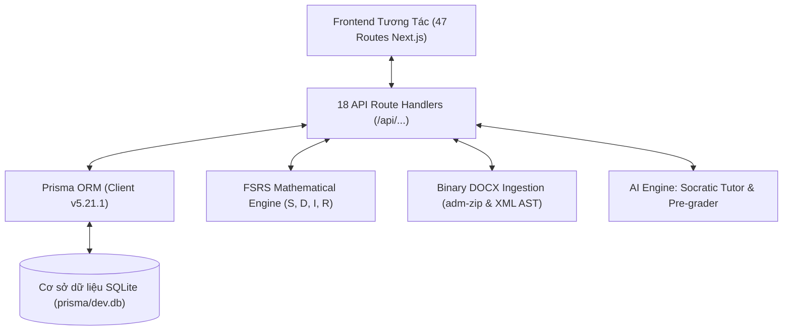

# Adaptive study — Full-Stack Real Implementation

> **Tên chính thức nền tảng**: **Adaptive study**  
> **Trạng thái phát triển**: **Phase 2 — Full-Stack Implementation Complete (Đã chuyển đổi hoàn toàn từ Prototype sang Hệ thống Thật)**  
> **Kiến trúc Công nghệ**: Next.js 14 (App Router) + TypeScript + Tailwind CSS + Prisma ORM + SQLite + FSRS Algorithm + Binary DOCX Parser  

---

## 1. Tổng Quan Kiến Trúc Đã Triển Khai Thật

Dự án đã được hiện thực hóa toàn diện từ tầng cơ sở dữ liệu, thuật toán đến tầng giao diện người dùng:



### 1.1. Cơ sở dữ liệu thật (Database & Prisma Schema)
* **Tệp cơ sở dữ liệu**: `prisma/dev.db` (SQLite).
* **Các bảng chuẩn hóa**:
  * `User`: Lưu thông tin học sinh, giáo viên, admin với mật khẩu mã hóa bcrypt (`bcryptjs`).
  * `Classroom` & `ClassroomMember`: Quản lý lớp học theo mã 6 ký tự độc nhất (Class Code).
  * `ThematicPack`, `VocabularyItem`, `WordFormFamily`, `GrammarTopic`, `Exercise`: Lưu trữ bộ học liệu theo chủ đề bóc tách từ file Word.
  * `UserVocab`: Lưu tiến trình ghi nhớ Spaced Repetition của từng học sinh theo thuật toán FSRS (*Stability, Difficulty, Reps, Lapses, NextReviewDate*).
  * `Assignment` & `Submission`: Quản lý giao bài, nộp bài, lưu song song điểm chính thức của Giáo viên và bản nháp phân tích của AI Pre-grade.
  * `StudentSkillProfile`: Đồ thị năng lực CEFR độc lập từng kỹ năng (Listening, Reading, Writing, Speaking, Grammar, Vocabulary).
  * `Notification`: Hệ thống thông báo thời gian thực.

### 1.2. Đường Ống Bóc Tách DOCX Nhị Phân Thật (Binary DOCX Parser)
* Không còn dùng mock data giả lập: Tích hợp thư viện `adm-zip` và bộ giải mã XML `word/document.xml`.
* Trích xuất trực tiếp toàn bộ ảnh nhị phân từ thư mục `word/media/` lưu vào `public/uploads/docx/` và gắn URL vào câu hỏi.
* Nhận diện cấu trúc bộ học liệu theo chủ đề `Unit 2: HEALTHY LIVING`:
  * **A. Vocabulary**: 41 từ/cụm từ có IPA và nghĩa tiếng Việt.
  * **B. Word Form**: 8 bảng họ từ phái sinh.
  * **C. Grammar**: Lý thuyết câu đơn ($S+V+Adv$, $S+V+C$, $S+V+O$, $S+V+prep+O$).
  * **D. Practice**: 27 dạng bài tập, tự động nhận diện câu hỏi trắc nghiệm, biển báo có ảnh, điền từ vào chỗ trống, chọn từ trong câu, bảng True/False có dấu X.
* Bật cờ cảnh báo chất lượng:
  * ⚠️ **Thiếu Audio**: Cảnh báo bắt buộc Giáo viên tải lên mp3 cho bài Listening (Ex 29, 30, 31).
  * ⚠️ **Lỗi Nguồn**: Đánh dấu lỗi ngữ pháp/typo trong tệp gốc (Ex 12 *"Jane feels should..."*) kèm đề xuất sửa riêng.

### 1.3. Thuật Toán Lặp Lại Ngắt Quãng Thật (FSRS Engine)
* Triển khai công thức toán học FSRS trong `src/lib/fsrs.ts`.
* Tính toán lại độ bền vững của trí nhớ (Stability $S$), độ khó của từ (Difficulty $D$) và khoảng cách ngày ôn tập tiếp theo ($I$) khi học sinh đánh giá 4 nút:
  * 1: **Again (Quên)** $\rightarrow$ Chuyển về trạng thái `relearning`, tăng số lần quên (lapses), ôn lại sau 1 ngày.
  * 2: **Hard (Khó)** $\rightarrow$ Ghi nhận đã nhớ nhưng độ khó tăng nhẹ.
  * 3: **Good (Nhớ)** $\rightarrow$ Tăng độ ổn định gấp đôi.
  * 4: **Easy (Dễ)** $\rightarrow$ Tăng độ ổn định gấp 3.5 lần.
* Tự động thăng cấp thành `mastered` khi khoảng thời gian ôn tập đạt $\ge 21$ ngày.

### 1.4. Trợ Lý AI Định Hướng Socratic & Chấm Nháp Định Hình
* **AI Socratic Tutor**: Hướng dẫn tư duy từng bước theo ngữ cảnh bài làm, tuyệt đối không đưa ra đáp án trực tiếp.
* **AI Pre-grader**: Tự động chấm nháp bài viết Writing và phát âm Speaking theo 4 tiêu chí CEFR ngay khi học sinh bấm nộp bài để Giáo viên tham khảo.

---

## 2. Danh Sách 18 API Routes Đã Hoạt Động

| Phương thức | Tuyến API | Chức năng |
|---|---|---|
| `POST` | `/api/auth/login` | Đăng nhập thật với email & bcrypt password, thiết lập session cookie. |
| `POST` | `/api/auth/register` | Đăng ký tài khoản mới và khởi tạo đồ thị năng lực CEFR. |
| `GET` | `/api/auth/me` | Lấy thông tin tài khoản hiện tại và danh sách lớp học từ DB. |
| `POST` | `/api/auth/logout` | Xóa session cookie đăng xuất. |
| `POST` | `/api/auth/switch-role` | Chuyển đổi nhanh giữa các tài khoản mẫu trong DB (`student`, `teacher`, `admin`). |
| `GET` | `/api/vocab` | Lấy danh sách từ vựng FSRS, số lượng theo 5 trạng thái và số thẻ đến hạn hôm nay. |
| `POST` | `/api/vocab` | Thêm từ mới hoặc nạp hàng loạt 41 từ từ Thematic Pack vào hàng đợi của học sinh. |
| `POST` | `/api/vocab/review` | Ghi nhận đánh giá flashcard, chạy thuật toán FSRS và cập nhật lịch ôn vào DB. |
| `POST` | `/api/vocab/settings` | Lưu hạn mức học từ mới mỗi ngày (5, 10, 20 từ). |
| `GET` | `/api/classes` | Lấy danh sách lớp học của Học sinh hoặc Giáo viên. |
| `POST` | `/api/classes` | Giáo viên tạo lớp học mới với mã tham gia 6 ký tự tự sinh. |
| `POST` | `/api/classes/join` | Học sinh nhập mã 6 ký tự để tham gia lớp học. |
| `GET` | `/api/classes/[id]` | Chi tiết lớp học, danh sách học sinh và sổ điểm (Gradebook). |
| `GET` | `/api/assignments` | Danh sách bài tập được giao theo lớp. |
| `POST` | `/api/assignments` | Giáo viên tạo bài tập mới hoặc phát hành từ Thematic Pack. |
| `POST` | `/api/submissions` | Học sinh nộp bài tập, tự động kích hoạt AI Pre-grade tính điểm tham khảo. |
| `POST` | `/api/grading/[submissionId]` | Giáo viên nhập điểm chính thức, nhận xét và công bố kết quả. |
| `POST` | `/api/ai/tutor` | Gợi ý định hướng Socratic thời gian thực. |
| `POST` | `/api/teacher/import-docx` | Upload tệp Word `.docx` nhị phân, trích xuất ảnh và lưu cấu trúc vào DB. |
| `GET` | `/api/admin/stats` | Thống kê số lượng người dùng, lớp học, bài tập thực tế trong DB. |
| `GET` | `/api/admin/users` | Quản lý danh sách người dùng với bộ lọc và tìm kiếm. |

---

## 3. Hướng Dẫn Khởi Chạy & Kiểm Thử

### 3.1. Chạy Máy Chủ Phát Triển (Development Server)
```bash
cd "c:\Users\Administrator\Documents\Codespace\Adaptive Learning\adaptiveenglish\english-learning-platform"
npm run dev
```
Truy cập: **`http://localhost:3000`**

### 3.2. Chạy Script Kiểm Thử Tự Động Các API
```bash
node test-apis.js
```
*(Tất cả 9 bài kiểm thử API login, vocab, FSRS review, class, submissions, AI pre-grade, AI tutor và admin stats đều trả về HTTP 200 OK)*.

### 3.3. Tài Khoản Đã Cung Cấp Sẵn Trong Database (Password: `password123`)
* **Học sinh (Student)**: `student@example.com`
* **Giáo viên (Teacher)**: `teacher@example.com`
* **Quản trị viên (Admin)**: `admin@example.com`
