# AI Workflow Diagram

Sơ đồ mô tả cơ chế hoạt động, kiểm soát bảo mật và ranh giới nghiệp vụ của 3 phân hệ AI trong nền tảng: **Context-Aware AI Tutor**, **Formative Writing Evaluator**, và **Teacher AI Copilot**.

```mermaid
flowchart TD
    subgraph TUTOR_ENGINE["1. CONTEXT-AWARE AI TUTOR WORKFLOW"]
        StudentPrompt["Học sinh gửi câu hỏi / Xin trợ giúp"]
        ContextCollector["Bộ nạp Ngữ cảnh Động:
        - Tên, Estimated IELTS Band, Điểm yếu
        - Câu hỏi đang làm trên màn hình
        - Cờ nhận diện: is_teacher_assignment"]
        
        CheckTeacherFlag{Là bài tập Giáo viên giao?}
        
        CheckTeacherFlag -- "ĐÚNG: is_teacher_assignment == true" --> SocraticGuard["KÍCH HOẠT SOCRATIC TUTOR MODE
        • CẤM đưa ra đáp án trực tiếp (A/B/C/D)
        • CẤM viết hộ câu / đoạn văn
        • Chỉ đưa ra gợi ý từng bước & đặt câu hỏi định hướng"]
        
        CheckTeacherFlag -- "SAI: Tự học tự do" --> StandardTutor["Chế độ Gia sư Mở: Giải thích chi tiết bản chất"]
        
        SocraticGuard & StandardTutor --> LLMTutorResponse["Gửi câu trả lời sư phạm cho học sinh"]
    end

    subgraph WRITING_ENGINE["2. FORMATIVE WRITING EVALUATION WORKFLOW"]
        EssayInput["Học sinh nộp bài luận (>= 250 từ)"]
        MultiPass["Multi-Pass Analysis theo IELTS Rubric:
        - Task Response Pass
        - Coherence & Cohesion Pass
        - Lexical Resource & Repetition Pass
        - Grammatical Range & Accuracy Pass"]
        
        ExtractActions["CHUYỂN HÓA FEEDBACK THÀNH HÀNH ĐỘNG HỌC (Moat)
        • Phát hiện lỗi mạo từ ──► Sinh Micro-drill Mạo từ
        • Phát hiện lặp từ ──► Đẩy từ thay thế vào Kho từ SRS
        • Phát hiện câu rời rạc ──► Đề xuất bài học Cohesive Devices"]
        
        EssayInput --> MultiPass --> ExtractActions
    end

    subgraph COPILOT_ENGINE["3. TEACHER AI COPILOT WORKFLOW"]
        TeacherTrigger["Giáo viên yêu cầu sinh bài (Theo chủ đề hoặc Điểm yếu của lớp)"]
        SynthesizeWeakness["Quét dữ liệu lỗi thực tế của học sinh trong lớp"]
        AIGenerateDraft["AI sinh bài tập nháp (DRAFT)"]
        
        TeacherGate{"PHỄU DUYỆT BẮT BUỘC (Human-in-the-loop)"}
        
        AIGenerateDraft --> TeacherGate
        TeacherGate -- "Không đạt" --> RejectRegen["Giáo viên bấm Regenerate hoặc Sửa trực tiếp"]
        RejectRegen --> TeacherGate
        TeacherGate -- "Đạt chuẩn" --> ApprovePublish["Giáo viên APPROVED ──► Xuất bản cho học sinh"]
    end
```

