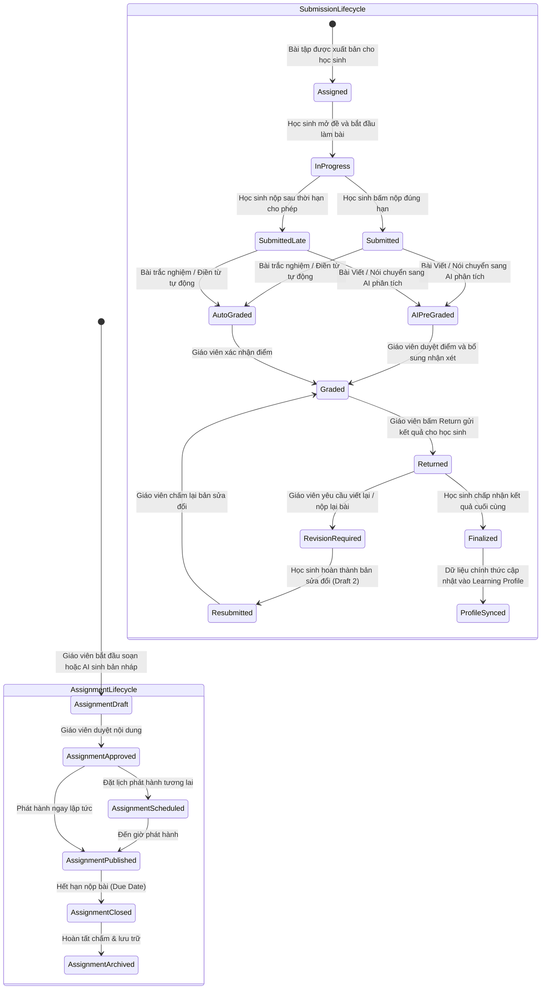

# Assignment Lifecycle State Diagram

Sơ đồ máy trạng thái biểu diễn toàn bộ vòng đời của Bài tập (Assignment) và Bài nộp của học sinh (Submission), bao gồm cả vòng lặp yêu cầu làm lại (Revision Loop).

