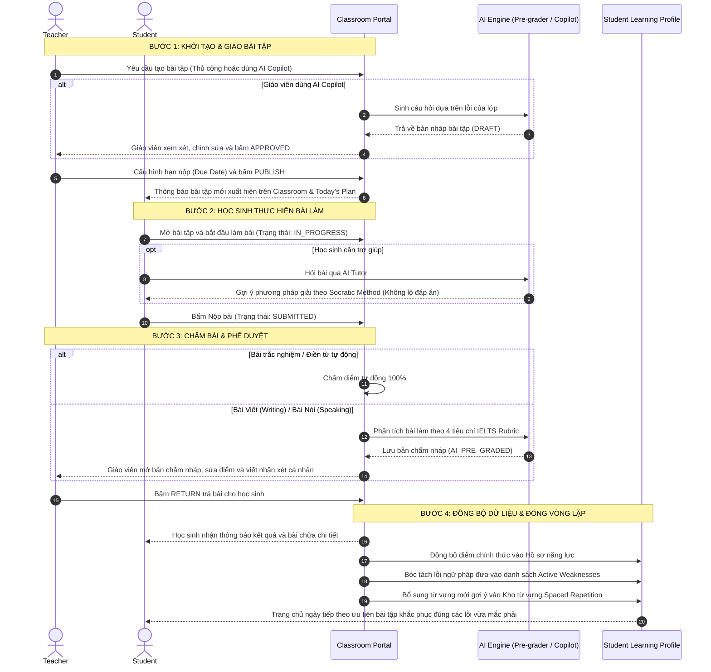

# Classroom Flow Diagram

Sơ đồ mô tả quy trình tương tác và luồng dữ liệu hai chiều trong không gian Lớp học (Classroom Learning), từ phân cấp học thuật đến quá trình nộp bài, chấm bài và phản hồi.

