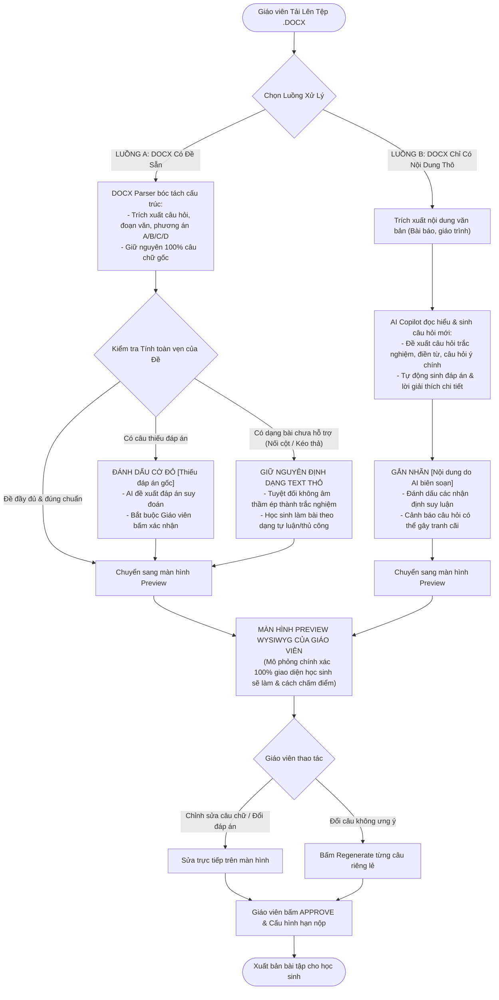

# DOCX Ingestion Dual-Pipeline Diagram

Sơ đồ mô tả chi tiết hai luồng xử lý nhập liệu tệp Word (.DOCX) cho giáo viên, phân tách rạch ròi giữa việc parse đề thi có sẵn và việc dùng AI sinh câu hỏi từ tài liệu thô.

