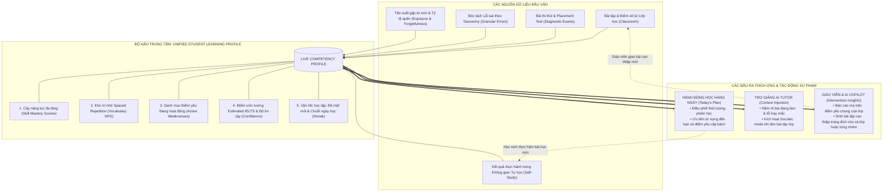

# Learning Profile Closed Loop Diagram

Sơ đồ thể hiện chi tiết dòng chảy dữ liệu của **Vòng lặp học tập khép kín (The Closed Learning Loop)**: Dữ liệu đa nguồn hội tụ về Student Learning Profile và phân phối thành các hành động can thiệp cụ thể.

