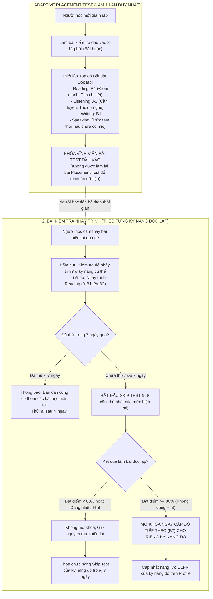

# Skill-Based Level-Skip Workflow Diagram

Sơ đồ phân biệt rạch ròi giữa bài kiểm tra đầu vào (Placement Test làm 1 lần duy nhất) và bài kiểm tra nhảy trình độc lập theo từng kỹ năng (Skill-Based Level-Skip Test).

