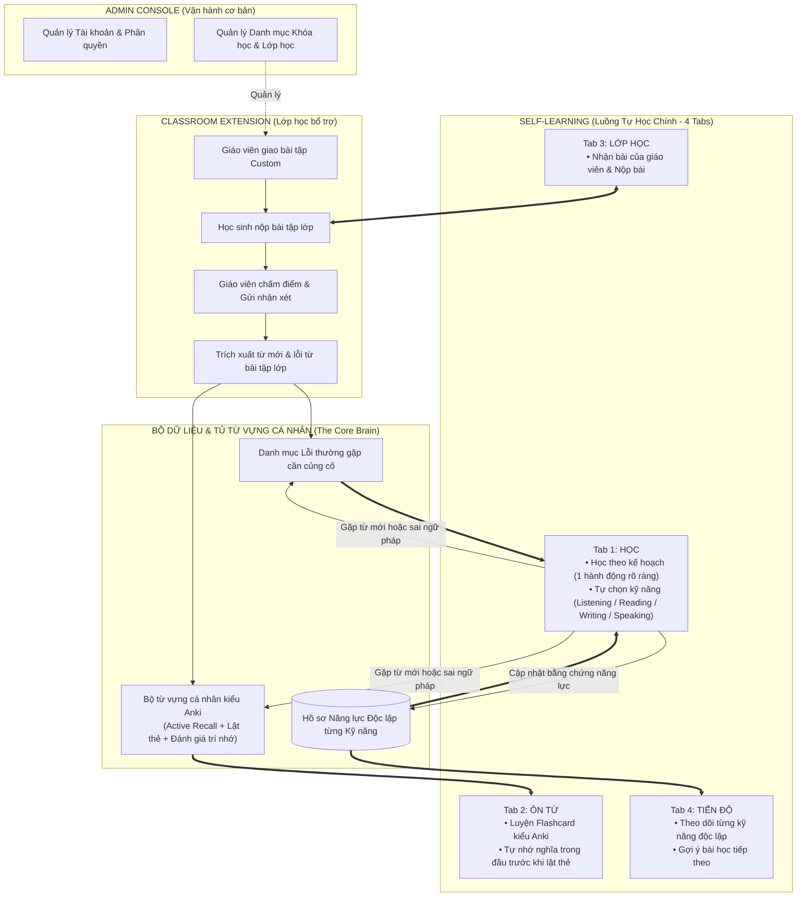

# Overall Product Flow Diagram

Sơ đồ thể hiện kiến trúc sản phẩm mới: **Tự học là luồng chính**, **Classroom là phần bổ trợ**, và **Admin là phần quản trị vận hành cơ bản**. Mọi hoạt động từ lớp học và tự học đều phục vụ việc học cá nhân.

