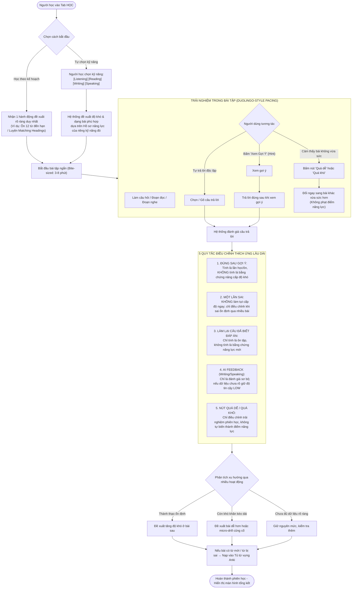

# Self-Learning Flow Diagram

Sơ đồ mô tả quy trình tự học IELTS-inspired, phân định giữa việc **Người dùng chọn kỹ năng** và **Hệ thống đề xuất độ khó**, cùng các quy tắc thích ứng khoa học kiểm soát độ khó lâu dài.

