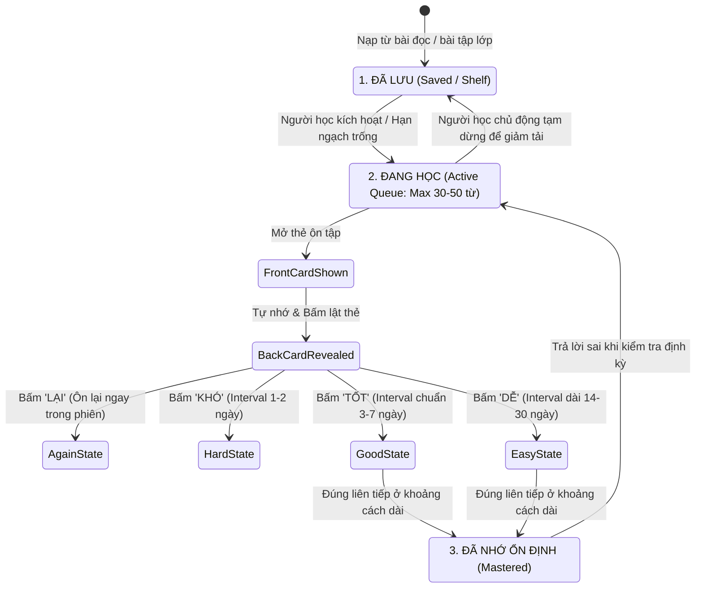

# 07 - Vocabulary Workflow

## Goal
Quy định cơ chế hoạt động của **Bộ Từ Vựng Cá Nhân Kiểu Anki (Personal Flashcard Deck)** – kết hợp nguyên lý gợi nhớ chủ động (Active Recall) và thuật toán lặp lại ngắt quãng (Spaced Repetition) với trải nghiệm người dùng tinh gọn, đóng vai trò cầu nối dữ liệu giữa bài học tự học và bài tập trên lớp.

## Actor
- Student (Người tự học ôn từ)
- Teacher (Giáo viên giao từ vựng qua bài tập lớp)
- System Vocabulary Engine (Bộ phận chọn lọc và điều phối thẻ flashcard)

## Preconditions
- Người học đã hoàn tất bài kiểm tra đầu vào và có ít nhất một nguồn nạp từ vựng vào bộ từ cá nhân.

## Trigger
- Học sinh mở tab `ÔN TỪ`, hoặc bấm vào hành động đề xuất trên Trang chủ (ví dụ: *“Ôn 12 từ đến hạn hôm nay”*).

---

## Main Flow: Ôn Từ Kiểu Anki & Cơ Chế Active Recall

### 1. Nguồn Nạp Từ Vào Bộ Từ Cá Nhân (Living Lexical Pipeline)
Học sinh không cần tạo bộ thẻ (deck) thủ công từ con số 0. Từ vựng tự động chảy vào bộ từ cá nhân từ 4 nguồn chính:

```
[1. BÀI TỰ HỌC: READING & LISTENING]
  • Học sinh tra từ nhanh khi đọc/nghe hoặc trả lời sai câu hỏi liên quan đến từ đó
       ↓
[2. BÀI TẬP LỚP HỌC (CLASSROOM)]
  • Giáo viên giao bài tập có chứa bộ từ vựng trọng tâm cần học
       ↓
[3. FEEDBACK CỦA GIÁO VIÊN & AI]
  • Bài viết bị chỉ ra lỗi lặp từ đơn giản → Đề xuất từ vựng học thuật thay thế
       ↓
[4. CHỦ ĐỘNG THÊM TỪ]
  • Học sinh bấm biểu tượng dấu cộng [+] để lưu bất kỳ từ nào mình thấy thú vị
       │
       ▼
[BỘ TỪ CÁ NHÂN (PERSONAL FLASHCARD DECK)]
```

---

### 2. Trải Nghiệm Lật Thẻ Active Recall & Quy Chuẩn 4 Nút Đánh Giá (FSRS Buttons)
Khác với bài trắc nghiệm 4 phương án, trải nghiệm tại tab `Ôn từ` tuân thủ nguyên tắc **Gợi nhớ chủ động (Active Recall)**:

```
┌────────────────────────────────────────────────────────┐
│                   MẶT TRƯỚC CỦA THẺ                    │
│                                                        │
│                      inevitable                        │
│                   /ɪnˈev.ə.t̬ə.bəl/                     │
│                                                        │
│   "Some degree of change is ________ in any business."  │
│                                                        │
│         [ BẮT BUỘC NGƯỜI HỌC TỰ NHỚ NGHĨA TRONG ĐẦU ] │
│                                                        │
│                  [ BẤM ĐỂ LẬT THẺ → ]                  │
└────────────────────────────────────────────────────────┘
                           │
                           ▼ (Người học bấm lật thẻ)
┌────────────────────────────────────────────────────────┐
│                    MẶT SAU CỦA THẺ                     │
│                                                        │
│               Nghĩa: Không thể tránh khỏi              │
│       Ví dụ hoàn chỉnh: Some degree of change is       │
│               inevitable in any business.              │
│                                                        │
│ ────────────────────────────────────────────────────── │
│     ĐÁNH GIÁ MỨC ĐỘ GHI NHỚ THỰC TẾ (FSRS RATINGS):    │
│                                                        │
│   [ QUÊN (Again) ]   [ KHÓ (Hard) ]                    │
│    (Không nhớ ra)     (Vẫn nhớ được, nhưng vất vả)     │
│                                                        │
│   [ NHỚ (Good) ]     [ DỄ (Easy) ]                     │
│    (Nhớ chuẩn xác)    (Phản xạ tức thì)                │
└────────────────────────────────────────────────────────┘
```

#### Quy Tắc Sống Còn Của 4 Nút Đánh Giá:
* **QUÊN (Again)**: **Hoàn toàn không nhớ ra nghĩa**. Thẻ xuất hiện lại ngay trong phiên sau 3–5 thẻ. FSRS đưa từ vào trạng thái *Cần học lại* và reset chu kỳ.
* **KHÓ (Hard)**: **VẪN NHỚ ĐƯỢC NGHĨA**, nhưng mất thời gian suy nghĩ lâu hoặc do dự. FSRS tăng nhẹ độ ổn định $S$ và tăng độ khó $D$.
  > [!IMPORTANT]
  > **Quy tắc sư phạm cốt lõi**: Phải giải thích rõ cho người học: *“Khó” là VẪN NHỚ ĐƯỢC*; nếu *HOÀN TOÀN KHÔNG NHỚ* thì bắt buộc phải chọn *“Quên”*. Đây là điều kiện tiên quyết để FSRS lên lịch chính xác.
* **NHỚ (Good)**: Nhớ ra chuẩn xác trong vòng vài giây mà không cần gắng sức quá mức.
* **DỄ (Easy)**: Từ đã quá quen thuộc, phản xạ tức thì không chút do dự. FSRS mở rộng khoảng cách ôn tối đa.

---

### 3. Hệ Thống 5 Trạng Thái Từ Vựng & Tiêu Chí "Nhớ Ổn Định" (Mastery Criteria)

Hệ thống theo dõi tiến trình ghi nhớ của từng từ qua 5 trạng thái rõ ràng:

| Trạng Thái (Status) | Ý Nghĩa Sư Phạm | Hành Vi FSRS & Lên Lịch |
| :--- | :--- | :--- |
| **1. Đã lưu (Saved)** | Đã lưu vào kho cá nhân nhưng chưa bắt đầu học. | Nằm trên giá sách (Shelf); chưa có lịch ôn tập. |
| **2. Đang học (Learning)** | Đang hình thành liên kết trí nhớ ban đầu. | Ôn tập ngắn ngày (Interval < 3 ngày). |
| **3. Đang củng cố (Consolidating)** | Đã nhớ nhưng cần ôn tương đối thường xuyên. | Khoảng cách ôn mở rộng dần (3 đến 20 ngày). |
| **4. Nhớ ổn định (Stable / Mastered)** | Đạt đủ 3 tiêu chí làm chủ (Mastery). | Tiếp tục ôn theo FSRS với khoảng cách dài ($\ge 21$ ngày). |
| **5. Cần học lại (Relearning / Lapsed)** | Đã từng nhớ nhưng bị quên ở lần ôn gần nhất. | Quay lại củng cố ngắn ngày để tái thiết lập trí nhớ. |

#### Ba Tiêu Chí Bắt Buộc Để Đạt Nhãn "Nhớ Ổn Định":
Một từ chỉ được gắn nhãn **“Nhớ ổn định”** khi thỏa mãn đồng thời cả 3 điều kiện:
1. Đã vượt qua giai đoạn học ban đầu.
2. **Nhớ đúng ở ít nhất 3 ngày khác nhau**, trước khi xem đáp án (chống hiện tượng bấm "Dễ" 1 lần nhảy cóc lên Mastery).
3. Sau lần ôn thành công gần nhất, **thuật toán FSRS lên lịch lần tiếp theo cách ít nhất 21 ngày** (chuẩn Mature của Spaced Repetition).

* **Nguyên tắc bảo toàn trạng thái**: Từ "Nhớ ổn định" đến hạn ôn tập sẽ hiển thị nhãn `Đến hạn ôn`, **tuyệt đối không lập tức xóa thành quả**. Chỉ khi người học bấm *Quên (Again)* thì từ mới chuyển sang `Cần học lại`.
* **Mastery tính theo từ tiếng Anh**: Mỗi từ tiếng Anh có một trạng thái tổng. Nếu từ có nhiều thẻ kiểm tra (thẻ từ vựng, thẻ cụm collocation), lịch ôn theo từng thẻ; trạng thái tổng chỉ đạt khi các thẻ cốt lõi đã đạt.

---

### 4. Quản Lý Giới Hạn Từ Mới & Kiểm Soát Nợ Ôn Tập (New Words Quota)

FSRS mặc định đặt mục tiêu nhớ lại **90% (Desired Retention = 0.90)**. Thêm nhiều từ mới hôm nay sẽ tạo ra áp lực ôn tập rất lớn sau 7–14 ngày. Do đó, app cung cấp các mức giới hạn từ mới/ngày do người học chủ động chọn:

| Lựa Chọn Hạn Mức | Từ Mới / Ngày | Cách Hiển Thị & Khuyến Nghị |
| :--- | :---: | :--- |
| **Nhẹ (Light)** | 5 từ | Dễ bắt đầu, không áp lực ôn tập. |
| **Vừa (Moderate)** | 10 từ | **Gợi ý ban đầu (Mặc định tối ưu)**. |
| **Nhiều (Intensive)** | 20 từ | Cần dành nhiều thời gian ôn mỗi ngày. |
| **Tùy chỉnh (Custom)** | $N$ từ | Người học tự nhập theo nhu cầu cá nhân. |
| **Không giới hạn (Unlimited)** | $\infty$ | **Không khuyến nghị**. Hiển thị cảnh báo 1 lần: *“Thêm nhiều từ hôm nay sẽ tăng đột biến lượng ôn những ngày sau”*. |

#### Quy Tắc Vận Hành Hạn Mức Từ Mới:
1. **Tính tổng trên mọi bộ từ**: Giới hạn chỉ áp dụng cho từ bắt đầu chuyển từ nhóm `Đã lưu` sang `Đang học` trong ngày. Người học vẫn được lưu/import bao nhiêu từ tùy thích vào kho.
2. **KHÔNG cộng dồn suất từ mới**: Nếu người học nghỉ học 3 ngày, hạn mức ngày thứ 4 vẫn là 10 từ, không bị dồn thành 30 từ (tránh gây ngợp nản chí).
3. **Ưu tiên ôn từ đến hạn trước**: Phiên học bắt buộc ưu tiên giải quyết thẻ đến hạn trước khi giới thiệu từ mới.
4. **Cảnh báo tồn đọng bài ôn (Backlog Throttling)**: Khi số thẻ đến hạn tồn $> 25$ thẻ, app hiển thị đề xuất: *“Bạn đang có nhiều từ cần ôn. Đề xuất tạm dừng từ mới hôm nay để tập trung củng cố”*. Quyết định cuối cùng thuộc về người học.
5. **Gợi ý thích ứng theo lịch sử**: Sau khi có dữ liệu học tập 14 ngày, app tự động gợi ý hạn mức tối ưu dựa trên tốc độ ôn thực tế và thời gian học hàng ngày của người dùng.



---

### 4. Vòng Lặp Đóng Kín Trong Thực Tế Học Tập (Connecting Loop)
* **Kịch bản gặp lại trong ngữ cảnh**:
  1. Hôm nay học sinh ôn từ *“inevitable”* và bấm `TỐT`.
  2. Ba ngày sau, học sinh vào tab `Học`, chọn một bài Reading về chủ đề *Technology*.
  3. Hệ thống ưu tiên chọn một đoạn văn có chứa từ *“inevitable”* để học sinh được nhìn thấy từ này trong ngữ cảnh đọc thực tế.
  4. Nếu trả lời đúng câu hỏi đọc hiểu liên quan, chỉ số ghi nhớ của từ đó được củng cố kép.

---

## Alternative Flows
- **Chế độ Luyện viết từ (Spelling Practice)**: Với những học sinh hay viết sai chính tả, sau khi lật thẻ, hệ thống cung cấp thêm ô gõ chính tả ngắn để rèn luyện trí nhớ vận động tay (Motor Memory).

---

## Error / Edge Cases
- **Học sinh bấm nhầm nút đánh giá (Mis-click)**: Cung cấp nút `[Hoàn tác (Undo)]` trong vòng 3 giây để người học lật lại thẻ và chọn đúng mức độ ghi nhớ thực tế.

---

## State Changes
- Cập nhật số lượng thẻ đã hoàn thành trong ngày.
- Cập nhật thời điểm ôn tập tiếp theo (`next_review_timestamp`) của từng từ.

---

## Data Conceptually Involved
- `VocabularyCard`, `ActiveRecallRating`, `SpacedIntervalRecord`, `ContextSentenceSnippet`, `DailyReviewQuota`.

---

## AI Involvement
- AI tự động sinh câu ví dụ ngắn gọn, chuẩn ngữ pháp và sát ngữ cảnh theo đúng trình độ hiện tại của người học khi thêm từ mới.

---

## Permissions
- Học sinh toàn quyền quản lý, gắn sao ưu tiên hoặc xóa từ khỏi kho cá nhân của mình.

---

## Open Questions
- Xem [`docs/20-open-questions.md`](20-open-questions.md) mục `Content` (Q-009).
