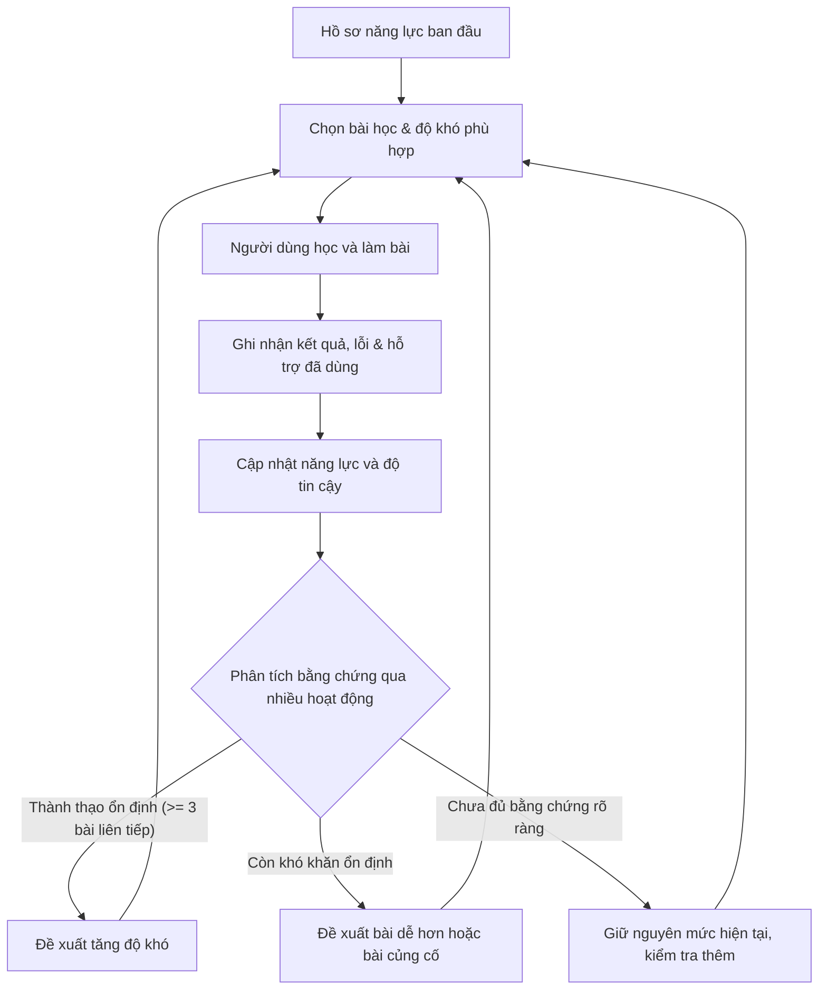

# 14 - Learning Profile Workflow

## Goal
Quy định cơ chế hoạt động của **Hồ Sơ Năng Lực Học Sinh Đa Chiều (Independent Skill Competency Profile)** – nơi quản lý năng lực độc lập từng kỹ năng, phân định rõ năng lực cốt lõi và năng lực bổ trợ, cùng các quy tắc thích ứng khoa học (Adaptive Leveling Rules) để điều chỉnh độ khó trong quá trình học tập lâu dài.

## Actor
- Student Learning Profile Engine (Bộ tính toán ngầm)
- Student (Người học sở hữu hồ sơ)
- Adaptive Recommendation Engine (Bộ điều phối độ khó và bài học tiếp theo)

## Preconditions
- Người học đã hoàn tất bài kiểm tra đầu vào (Placement Test 8–12 phút) để khởi tạo các điểm xuất phát ban đầu.

## Trigger
- Bất kỳ hoạt động học tập nào diễn ra: Trả lời 1 câu hỏi, lật 1 thẻ flashcard, nộp bài tập lớp, bấm nút "Quá dễ / Quá khó", hoặc giáo viên trả bài chấm.

---

## Main Flow: Hồ Sơ Năng Lực Độc Lập & Cơ Chế Thích Ứng

### 1. Nguyên Tắc Cốt Lõi: Không Dùng Một "Level Tổng" Duy Nhất
* **Không cào bằng năng lực**: Rất nhiều người học có khả năng Đọc hiểu rất tốt (B2/C1) nhưng khả năng Nói hoặc Viết lại ở mức cơ bản (A2/B1). Việc gộp tất cả thành một điểm tổng duy nhất rồi dùng điểm đó áp đặt độ khó cho mọi kỹ năng là sai lầm sư phạm nghiêm ngặt.
* **Độc lập 4 kỹ năng chính**:
  * `Reading Competency`: Cấp độ khởi đầu, điểm mạnh có bằng chứng, phần cần luyện, độ tin cậy.
  * `Listening Competency`: Cấp độ khởi đầu, khả năng bắt thông tin, độ tin cậy.
  * `Writing Competency`: Khả năng diễn đạt, ngữ pháp câu, vốn từ thực tế.
  * `Speaking Competency`: Khả năng diễn đạt nói, độ lưu loát (chỉ đánh giá khi có dữ liệu ghi âm rõ ràng; không dùng Writing suy ra Speaking).
* **Năng lực hỗ trợ (Supporting Competencies)**:
  * `Vocabulary Bank`: Số lượng từ đang học, số từ đã làm chủ, tỷ lệ nhớ lại khi lật thẻ flashcard.
  * `Grammar Competency`: Bản đồ các chuyên đề ngữ pháp đã vững và các lỗi sai còn tồn đọng.
  * *Nguyên tắc*: Từ vựng và Ngữ pháp đóng vai trò hỗ trợ, **KHÔNG cộng gộp với các kỹ năng khác để tạo thành level tổng**.

---

### 2. Bảng Trạng Thái Năng Lực Độc Lập Mẫu (Independent Competency Display)

```
┌────────────────────────────────────────────────────────────────────────┐
│                      HỒ SƠ NĂNG LỰC CỦA BẠN                            │
├─────────────┬─────────────────────┬───────────────────┬────────────────┤
│ Kỹ năng     │ Mức khởi đầu / Hiện tại │ Bằng chứng mạnh   │ Phần cần luyện │
├─────────────┼─────────────────────┼───────────────────┼────────────────┤
│ Reading     │ Bài đọc B1 cơ bản   │ Tìm thông tin trực tiếp│ Ý chính vs Chi tiết│
│ Listening   │ Tốc độ vừa phải     │ Bắt thông tin số  │ Nghe hiểu hội thoại│
│ Writing     │ Câu ghép cơ bản     │ Vốn từ đời sống   │ Cấu trúc câu phức  │
│ Speaking    │ [Chưa có dữ liệu]   │ Cần thêm ghi âm   │ Khả năng diễn đạt nói│
├─────────────┴─────────────────────┴───────────────────┴────────────────┤
│ Năng lực bổ trợ:                                                       │
│ • Từ vựng: 48 từ trong kho cá nhân (18 từ đã làm chủ hoàn toàn)        │
│ • Ngữ pháp: Vững các thì cơ bản; Cần củng cố: Mạo từ Articles         │
└────────────────────────────────────────────────────────────────────────┘
```

---

### 3. Quy Tắc Điều Chỉnh Thích Ứng Lâu Dài (Continuous Adaptive Rules)
Hệ thống không tăng hoặc giảm độ khó một cách bốc đồng; cơ chế điều chỉnh dựa trên 5 quy tắc nghiêm ngặt:



#### Chi tiết 5 quy tắc điều chỉnh:
1. **Quy tắc Phân biệt Hỗ trợ (Hint/Answer Penalty Rule)**:
   * Trả lời đúng **sau khi đã xem gợi ý (Hint) hoặc xem đáp án** được tính là một lần học/ôn tập, **KHÔNG ĐƯỢC TÍNH là bằng chứng tự làm chủ kiến thức**.
   * Chỉ những câu trả lời đúng độc lập ngay từ lần thử đầu tiên mới được dùng để nâng cấp độ khó.
2. **Quy tắc Ổn định Dữ liệu (Non-Instant Downgrade Rule)**:
   * **Một lần làm sai KHÔNG làm tụt cấp độ ngay lập tức**. Việc sai một câu có thể do đọc nhầm đề, gián đoạn mạng hoặc thao tác nhầm.
   * Hệ thống chỉ điều chỉnh giảm độ khó hoặc đề xuất bài củng cố khi người học gặp khó khăn ổn định qua nhiều hoạt động liên tiếp.
3. **Quy tắc Làm lại Câu cũ (Repeated Question Rule)**:
   * Việc làm lại một câu hỏi mà người học đã biết trước đáp án chỉ được ghi nhận như một hành động củng cố trí nhớ, **không được coi là bằng chứng năng lực mới tương đương với câu hỏi mới**.
4. **Quy tắc Đánh giá Sơ bộ của AI (Preliminary AI Rule)**:
   * Mọi đánh giá của AI đối với bài Viết ngắn hoặc bài Nói đều được xem là **đánh giá định hình sơ bộ**.
   * Khi dữ liệu audio bị rè hoặc bài viết quá ngắn, hệ thống **bắt buộc giữ độ tin cậy (Confidence) ở mức LOW**, không vội vàng nâng/hạ cấp độ của người học.
5. **Quy tắc Nút "Quá dễ / Quá khó" (User Subjective Feedback Rule)**:
   * Người học có thể bấm nút `[Quá dễ]` hoặc `[Quá khó]` ngay trong bài học để yêu cầu đổi bài tập khác.
   * **Tác động**: Lựa chọn này giúp điều chỉnh ngay lập tức trải nghiệm học tập của phiên hôm đó, **KHÔNG tự động biến thành điểm số năng lực** nhằm tránh trường hợp người học tự chỉnh ảo hồ sơ của mình.

---

### 4. Phân Tách Hai Quyền Hạn Trong Trải Nghiệm Học Tập
Hệ thống tách biệt tuyệt đối giữa 2 cơ chế:
* **Người dùng chọn**: Học kỹ năng nào (Reading, Listening, Writing, Speaking hay Ôn từ).
* **Hệ thống đề xuất**: Độ khó, dạng bài tập và các câu hỏi cụ thể bên trong kỹ năng đó dựa trên Profile.

---

## Alternative Flows
- **Học sinh yêu cầu kiểm tra xác nhận (Check-in Quiz)**: Sau 2 tuần học tập ổn định, học sinh có thể làm 1 bài kiểm tra xác nhận ngắn (3–5 phút) để hệ thống tăng độ tin cậy và chính thức nâng mức xuất phát lên bậc cao hơn.

---

## Error / Edge Cases
- **Làm bài trong trạng thái xao nhãng (Latency Outlier)**: Người dùng để màn hình chờ 15 phút rồi mới chọn bừa đáp án sai. Hệ thống nhận diện thời gian nhàn rỗi bất thường và loại trừ câu đó khỏi tập dữ liệu đánh giá độ khó.

---

## State Changes
- Cập nhật chỉ số `competency_level` và `confidence_tier` của từng kỹ năng độc lập.

---

## Data Conceptually Involved
- `SkillCompetencyRecord`, `ActivityEvidenceLog`, `HintUsageCounter`, `ConfidenceLevel`, `SubjectivePacingFeedback`.

---

## AI Involvement
- AI phân tích mẫu diễn đạt trong bài viết/nói để trích xuất bằng chứng năng lực sơ bộ.

---

## Permissions
- Học sinh xem toàn bộ hồ sơ chi tiết của mình. Giáo viên xem hồ sơ của học sinh trong lớp mình quản lý.

---

## Open Questions
- Xem [`docs/20-open-questions.md`](20-open-questions.md) mục `Assessment` (Q-010).
