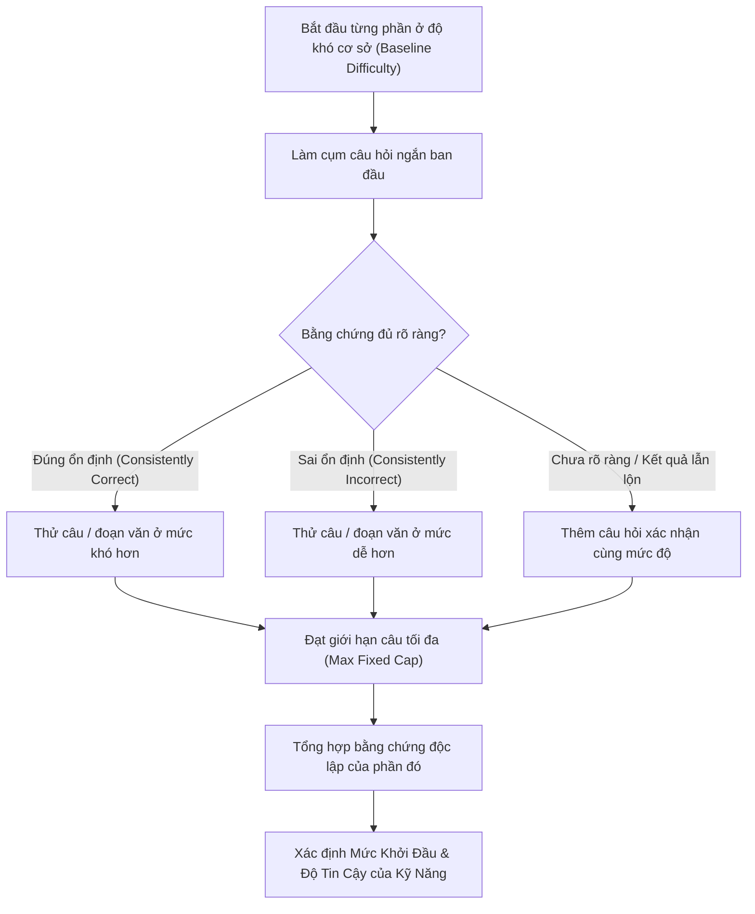

# 15 - Assessment & Placement Workflow

## Goal
Quy định cơ chế kiểm tra đầu vào thích ứng (Adaptive Placement Test: 8–12 phút), thuật toán điều chỉnh độ khó theo từng phần với giới hạn câu cố định (Fixed Cap), phương pháp tổng hợp bằng chứng độc lập cho từng kỹ năng, và các nguyên tắc đánh giá năng lực ngôn ngữ lấy cảm hứng từ IELTS mà không biến ứng dụng thành một lò luyện thi căng thẳng.

## Actor
- Student (Người tham gia kiểm tra và đánh giá)
- Placement & Diagnostic Scoring Engine (Bộ điều phối bài test thích ứng)

## Preconditions
- Người dùng bắt đầu phiên Onboarding lần đầu hoặc kích hoạt bài kiểm tra chẩn đoán lại định kỳ.

## Trigger
- Học sinh vượt qua màn hình khảo sát mục tiêu (hoặc bấm Skip) để bước vào bài kiểm tra đầu vào bắt buộc.

---

## Main Flow: Bài Kiểm Tra Đầu Vào Thích Ứng (8–12 Phút)

### 1. Cấu Trúc Bài Kiểm Tra Theo Từng Phần (Section Structure)
Bài kiểm tra được thiết kế cô đọng trong thời lượng **8–12 phút**, có thanh tiến độ (Progress Bar) hiển thị rõ ràng từng phần để người học luôn biết mình đang ở đâu:

| Phần (Section) | Hoạt Động Cụ Thể | Hệ Thống Quan Sát & Thu Thập Bằng Chứng |
| :--- | :--- | :--- |
| **1. Từ vựng & Ngữ pháp** | 4–6 câu điền từ hoặc nhận diện trong ngữ cảnh ngắn tự nhiên. | Khả năng hiểu nghĩa từ vựng cốt lõi, khả năng nhận diện cấu trúc ngữ pháp cơ bản và câu phức. |
| **2. Reading** | 1 đoạn văn ngắn (150–200 từ), 2–3 câu hỏi trắc nghiệm/logic. | Khả năng nắm bắt ý chính (Main Idea) và tìm kiếm thông tin chi tiết (Specific Details). |
| **3. Listening** | 1 đoạn audio ngắn (30–45 giây), 2–3 câu hỏi trắc nghiệm/điền từ. | Khả năng nhận diện thông tin nghe được, nhận diện con số và từ khóa quan trọng. |
| **4. Writing** | Viết 2–3 câu hoàn chỉnh theo prompt tình huống cho trước. | Khả năng biểu đạt ý mạch lạc, độ chính xác ngữ pháp câu, vốn từ sử dụng trong văn cảnh. |
| **5. Speaking** | Trả lời bằng giọng nói khoảng 30 giây theo câu hỏi gợi ý. | Khả năng diễn đạt nói, độ lưu loát; **chỉ ghi nhận khi audio đủ rõ và không có tạp âm lớn**. |

---

### 2. Quy Tắc Quyền Microphone (Mic Permission Policy)
* **Bắt buộc hoàn thành test KHÔNG ĐỒNG NGHĨA với bắt buộc cấp quyền Mic**.
* Nếu học sinh đang ở môi trường ồn ào (xe bus, quán cà phê), thiết bị hỏng mic, hoặc từ chối cấp quyền mic:
  * Người học có thể bấm nút `[Không thể ghi âm lúc này]`.
  * Hệ thống cho phép hoàn thành 4 phần còn lại bình thường.
  * Trong hồ sơ ban đầu, phần Speaking sẽ hiển thị: **“Chưa đánh giá (Cần thêm dữ liệu sau)”**.
  * **TUYỆT ĐỐI KHÔNG DÙNG điểm Writing để suy diễn hoặc gán điểm cho Speaking**. Hai kỹ năng này đòi hỏi cơ chế kích hoạt ngôn ngữ hoàn toàn khác nhau.

---

### 3. Cơ Chế Điều Chỉnh Độ Khó Trong Test (Section-Level Adaptive Branching)
Hệ thống **không hỏi toàn bộ người dùng cùng một bộ câu hỏi cố định** rồi cộng tổng điểm. Độ khó được điều chỉnh linh hoạt theo từng phần với **số câu tối đa cố định (Fixed Cap)** để người học không bị mệt mỏi:



#### Quy Tắc Phân Nhánh Thực Tế (Ví Dụ Với Kỹ Năng Reading):
* Bắt đầu với cụm 2 câu hỏi đầu tiên ở độ khó trung bình (B1 cơ bản): 1 câu ý chính, 1 câu chi tiết.
* Nếu trả lời đúng cả 2 câu một cách ổn định $\rightarrow$ Thử đoạn văn hoặc câu hỏi suy luận khó hơn (B2).
* Nếu trả lời sai cả 2 câu $\rightarrow$ Thử câu hỏi ở mức dễ hơn (A2).
* Nếu 1 đúng 1 sai (kết quả lẫn lộn) $\rightarrow$ Thêm 1 câu xác nhận ở cùng mức B1.
* **Nguyên tắc ngắt phiên (Cut-off Rule)**: Khi đạt đến số câu tối đa quy định của phần đó, bài test lập tức kết thúc phần đó và chuyển sang phần tiếp theo, ngay cả khi kết quả chưa đạt độ tin cậy tuyệt đối.
* **Thời gian làm bài chỉ là tín hiệu phụ**: Hệ thống không phạt điểm nếu học sinh đọc chậm, vì tốc độ có thể bị ảnh hưởng bởi màn hình điện thoại nhỏ, mạng lag hoặc bị gián đoạn bất chợt.

---

### 4. Kết Quả Sau Test: Hồ Sơ Độc Lập (No Single Global Level)
Hệ sinh thái từ chối áp dụng một "Level tổng" duy nhất cho người học. Mỗi kỹ năng được giữ riêng biệt:

```
┌────────────────────────────────────────────────────────────────────────┐
│               KẾT QUẢ KHỞI ĐẦU ĐƯỢC THIẾT LẬP CHO BẠN                  │
├─────────────┬──────────────────────────┬───────────────────────────────┤
│ Kỹ năng     │ Mức khởi đầu đề xuất     │ Tình trạng bằng chứng ban đầu │
├─────────────┼──────────────────────────┼───────────────────────────────┤
│ Reading     │ Bài đọc B1 cơ bản        │ • Điểm mạnh: Tìm thông tin tốt│
│             │                          │ • Cần luyện: Phân biệt ý chính│
│ Listening   │ Tốc độ vừa phải          │ • Nhận diện số và ngày tháng  │
│ Writing     │ Câu ghép cơ bản          │ • Ngữ pháp ổn, cần mở rộng từ │
│ Speaking    │ [Chưa đánh giá]          │ • Chưa cấp quyền ghi âm mic   │
├─────────────┴──────────────────────────┴───────────────────────────────┤
│ Năng lực bổ trợ (Vocabulary & Grammar):                                │
│ • Vốn từ nhận diện: ~1,200 từ cốt lõi                                  │
│ • Điểm ngữ pháp vững: Thì hiện tại đơn, quá khứ đơn                   │
│                                                                        │
│ ────────────────────────────────────────────────────────────────────── │
│ THÔNG ĐIỆP HỆ THỐNG:                                                   │
│ "Hệ thống đã chọn điểm bắt đầu phù hợp cho bạn. Mức này sẽ tự động     │
│  điều chỉnh liên tục khi bạn học và làm bài."                         │
│                                                                        │
│  [ BẮT ĐẦU BÀI ĐỀ XUẤT ĐẦU TIÊN (8 MIN) ]   [ TỰ CHỌN KỸ NĂNG ]       │
└────────────────────────────────────────────────────────────────────────┘
```

---

### 5. Cơ Chế Tinh Chỉnh Năng Lực Lâu Dài Trong Khi Học
Bài test đầu vào chỉ đóng vai trò chọn **tọa độ xuất phát (Starting Point)**. Toàn bộ quá trình thích ứng thực sự diễn ra trong các bài học hàng ngày:
* **Học sinh làm tốt nhiều bài liên tiếp** $\rightarrow$ Hệ thống tự động đề xuất các bài đọc/nghe có độ dài và độ phức tạp cao hơn.
* **Học sinh gặp khó khăn lặp lại** $\rightarrow$ Hệ thống chủ động giảm độ khó hoặc chèn các bài micro-drill củng cố khái niệm nền tảng.
* **Người dùng bấm nút "Quá dễ / Quá khó"** $\rightarrow$ Đổi bài tập ngay lập tức để duy trì trạng thái tập trung lý tưởng (Flow State), không tác động tiêu cực lên hồ sơ năng lực thực tế.

---

## Alternative Flows
- **Làm lại bài kiểm tra chẩn đoán (Diagnostic Retest)**: Người dùng có thể yêu cầu làm lại bài test sau mỗi 30 ngày học tập để đo lường mức độ tiến bộ toàn diện của tất cả các kỹ năng.

---

## Error / Edge Cases
- **Bị mất kết nối mạng khi đang gửi audio Speaking**: Hệ thống lưu tệp audio tạm thời trên bộ nhớ đệm thiết bị và tự động gửi lại khi có mạng, không bắt người dùng phải nói lại lần hai.

---

## State Changes
- Chuyển trạng thái người dùng từ `UNASSESSED` sang `ASSESSED_WITH_INDEPENDENT_PROFILES`.

---

## Data Conceptually Involved
- `AdaptiveTestSession`, `SectionEvidenceRecord`, `BranchingState`, `AudioQualityCheckLog`, `InitialCompetencyVector`.

---

## AI Involvement
- AI phân tích câu văn bản Writing để xác định khả năng cấu trúc câu.
- AI Speech Evaluator kiểm tra độ rõ ràng của phát âm và trường độ ngắt nghỉ khi audio đạt chuẩn.

---

## Permissions
- Học sinh chỉ làm bài test của mình. Giáo viên lớp có thể xem chi tiết bài test đầu vào của học sinh để hiểu rõ xuất phát điểm của từng em.

---

## Open Questions
- Xem [`docs/20-open-questions.md`](20-open-questions.md) mục `Assessment` (Q-002, Q-010).
