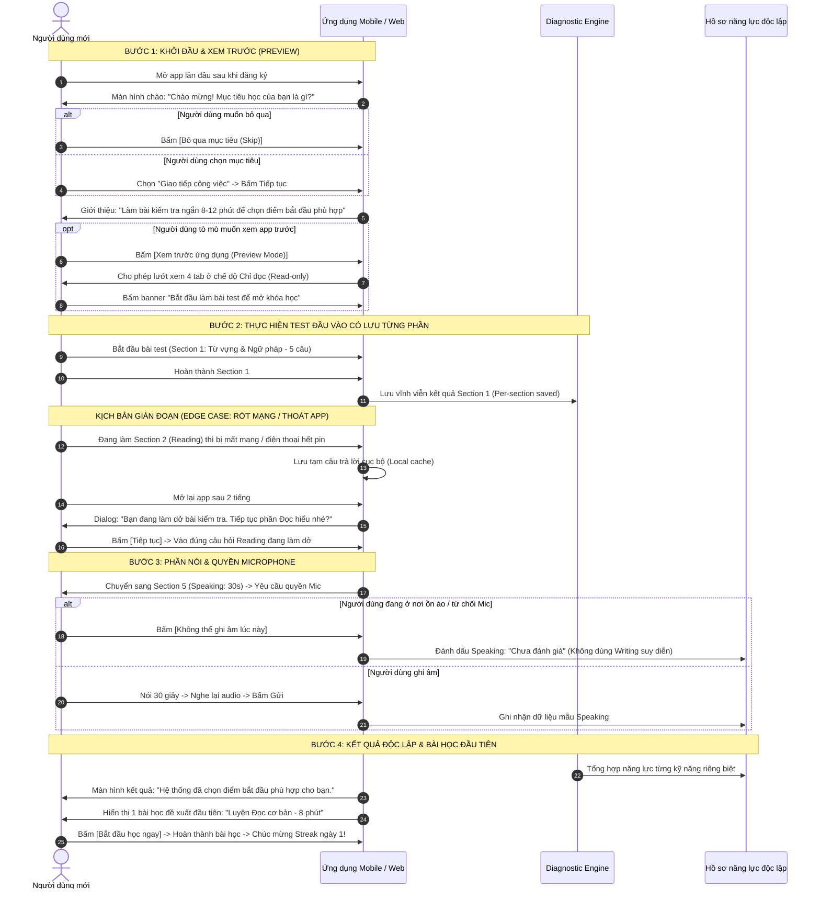

# 22 - UX Interaction Mechanics & Design System Rules

## Goal
Tài liệu này chuẩn hóa toàn bộ các **cơ chế tương tác vi mô (Micro-interactions)**, quy tắc điều hướng, logic phân bổ vị trí màn hình, nguyên tắc xử lý gián đoạn và quy chuẩn chuyển động (Motion & Consistency) để bàn giao trực tiếp cho UI/UX Designer và Frontend/Full-stack Developer trong các phase tiếp theo.

---

## 1. BẢNG CHỐT 9 CƠ CHẾ TƯƠNG TÁC CỐT LÕI (THE 9 INTERACTION MECHANICS)

| Cơ Chế UX | Vấn Đề Cần Làm Rõ | Quyết Định Thiết Kế & Quy Tắc Hành Vi Chuẩn |
| :--- | :--- | :--- |
| **1. Test đầu vào** | Thoát giữa chừng, mất mạng, chưa đủ dữ liệu thì sao? | • **Lưu trạng thái theo từng phần (Per-section persistence)**: Hoàn thành phần nào khóa dữ liệu phần đó. Mất mạng/thoát app quay lại làm tiếp đúng phần dở. • **Bắt buộc trước phiên học đầu**: Không thể bấm "Bắt đầu học" nếu chưa test xong. • **Cho phép xem trước (Explore/Preview Mode)**: Người dùng có thể lướt xem giao diện 4 tab ở chế độ chỉ đọc (Read-only) trước khi làm test. • **Thực tế hóa thời lượng**: Coi 8–12 phút là mục tiêu tham vọng cần A/B test; test chỉ tạo điểm xuất phát thô, tiếp tục hiệu chỉnh qua quá trình học. |
| **2. Trang chủ** | Học tiếp, ôn từ và bài lớp cạnh tranh vị trí thế nào? | • **Một hành động chính duy nhất (Single Primary Hero Action)**:   - Nếu có bài học tự học/bài test đang làm dở $\rightarrow$ Nút Hero là **“Tiếp tục bài đang dở”**.   - Nếu không $\rightarrow$ Nút Hero là **“Bài học đề xuất hôm nay”** (1 kỹ năng cụ thể, ví dụ: 8 phút). • **Ôn từ và Deadline lớp hiển thị riêng (Secondary Dedicated Cards)**: Nằm ngay dưới Hero Action thành 2 widget tách biệt: Thẻ *“Ôn 12 từ đến hạn”* và Thẻ *“Bài tập lớp (Hạn: 23:59)”*. |
| **3. Chọn bài** | Chọn kỹ năng thôi hay cả chủ đề, dạng bài và độ khó? | • **Cấp 1 (Primary Flow)**: Chọn kỹ năng (Listening / Reading / Writing / Speaking) $\rightarrow$ App gợi ý ngay 1 bài học phù hợp nhất với trình độ hiện tại. • **Cấp 2 (Deep Filter - Tùy chọn nâng cao)**: Cung cấp nút `[Bộ lọc]` cho phép người dùng chủ động đào sâu: lọc theo Dạng bài (ví dụ: *Matching Headings*), Chủ đề (ví dụ: *Environment*), hoặc Mức thử thách. |
| **4. Điều chỉnh độ khó** | App tự đổi hay hỏi người học? Có đổi giữa bài đang làm? | • **TUYỆT ĐỐI KHÔNG ĐỔI giữa bài đang làm**: Giữ nguyên bài tập hiện tại để tránh gây hoang mang, đứt gãy trải nghiệm. • **Điều chỉnh cho bài tiếp theo**: Hiển thị Toast/Banner thông báo ngắn gọn lý do (ví dụ: *“Bạn làm rất tốt các câu hỏi ý chính! Bài tiếp theo sẽ tăng nhẹ độ khó với câu hỏi suy luận”*). • **Nút “Quá dễ / Quá khó”**: Đổi sang bài tập khác ngay sau đó; lựa chọn này chỉ điều chỉnh độ thử thách, không tự động biến thành điểm năng lực. |
| **5. Feedback & Sửa sai** | Khi nào hiện đáp án, hint và giải thích? Tránh đúng/sai khô khan? | • **Phễu phản hồi sư phạm 4 bước (The 4-Step Feedback Funnel)**:   1. *Cho tự làm lần 1*.   2. *Nếu sai $\rightarrow$ Mở nút [Xem Gợi Ý (Hint)] để tự thử lại lần 2*.   3. *Nếu vẫn sai hoặc muốn xem $\rightarrow$ Mở [Giải thích chi tiết (Explain)] phân tích tại sao phương án đó sai*.   4. *Luyện lại bằng câu tương tự (Remedial Clone)* để củng cố ngay tức thì. |
| **6. Ôn từ vựng** | Tự thêm từ hay hệ thống thêm? Khi tồn nhiều thẻ thì sao? | • **Hệ thống đề xuất, Người dùng xác nhận**: Khi đọc/nghe gặp từ mới, app hiện chip gợi ý $\rightarrow$ Người dùng chạm để xác nhận thêm vào tủ (tránh rác kho từ). • **Xử lý tồn đọng thẻ (Backlog Management)**: Khi có $> 30$ thẻ đến hạn:   - Ưu tiên từ có nguy cơ quên cao nhất.   - Cho phép chọn **Phiên ôn ngắn (Quick Review: 5–10 thẻ)**.   - Công tắc **“Tạm dừng nạp từ mới”** cho đến khi giải quyết xong thẻ tồn. |
| **7. AI Tutor** | AI nằm ở đâu, biết gì, được giúp đến mức nào? | • **Vị trí**: Nút nổi tinh gọn hoặc kéo trượt (Bottom Sheet / Drawer) ngay trong màn hình bài tập; không mở cửa sổ chat toàn màn hình làm mất ngữ cảnh. • **Ngữ cảnh**: Nắm rõ câu hỏi, đoạn văn, và các lựa chọn học sinh đang xem. • **Với bài tập lớp**: Tuân thủ chính sách của giáo viên (ví dụ: *“Chỉ giải thích lý thuyết, không đưa đáp án”*); hệ thống hiển thị thông báo quy chế trước khi học sinh hỏi. |
| **8. Classroom** | Lưu nháp, nộp lại, quá hạn và feedback hoạt động ra sao? | • **Giao diện đồng nhất**: Màn hình làm bài tập lớp dùng chung 100% component với bài tự học, chỉ thêm Header hiển thị tên lớp, hạn nộp và trạng thái (`Chưa nộp` / `Đã nộp`). • **Lưu nháp tự động (Autosave)**: Mọi câu trả lời lưu cục bộ và đám mây theo thời gian thực. • **Chính sách Deadline / Nộp lại**: Do giáo viên cấu hình (Cho phép nộp muộn có gắn cờ / Yêu cầu viết lại bản thảo 2). |
| **9. Tiến độ** | Hiển thị thế nào để người dùng hiểu mình tiến bộ? | • **Tách biệt 2 trục nhận thức rõ ràng**:   1. *Trục Cần Cù (Effort / Volume)*: Số ngày liên tiếp (Streak), số bài đã hoàn thành, số từ đã lật thẻ.   2. *Trục Năng Lực Thực Chất (Demonstrated Competency)*: Mức độ làm chủ từng kỹ năng độc lập, bằng chứng mạnh cụ thể, và cảnh báo phần chưa đủ dữ liệu đánh giá. |

---

## 2. QUY CHUẨN TÍNH NHẤT QUÁN & TRẢI NGHIỆM CHUYỂN ĐỘNG (UX MOTION & CONSISTENCY)

### 2.1. Quy Chuẩn Điều Hướng (Navigation Uniformity)
* **Vào bài (Enter)**: Trượt nhẹ từ phải sang trái (Slide in from right) hoặc đẩy lên từ dưới (Modal slide up).
* **Quay lại / Thoát (Back / Exit)**:
  * Nút `[X]` hoặc mũi tên quay lại luôn nằm ở góc trên bên trái.
  * Nếu đang làm dở bài tập: **Bắt buộc hiển thị Dialog xác nhận nhẹ nhàng**:  
    *“Tiến trình của bạn đã được tự động lưu. Bạn có muốn tạm dừng không?”* $\rightarrow$ Nút: `[Tạm dừng và Thoát]` / `[Tiếp tục học]`.
* **Tiếp tục (Resume)**: Bấm vào bài đang dở sẽ đưa người dùng trở lại **chính xác câu hỏi hoặc đoạn văn đang làm dở**, không bắt làm lại từ câu 1.

### 2.2. Trạng Thái Lưu Dữ Liệu Minh Bạch (Data Persistence Visibility)
* Góc trên màn hình hiển thị biểu tượng mờ kèm text: `Đã lưu nháp` (Autosaved) sau mỗi thao tác chọn đáp án hoặc gõ văn bản.
* Tệp ghi âm Speaking được nén và lưu tạm cục bộ ngay trên máy; người dùng có nút `[Nghe lại]` trước khi bấm gửi. Nếu mất mạng, file âm thanh được giữ nguyên trong hàng đợi ngoại tuyến.

### 2.3. Quy Chuẩn Phản Hồi Tương Tác (System Feedback Uniformity)
* **Gợi ý (Hint)**: Luôn trượt lên dưới dạng Bottom Sheet màu vàng nhạt/trung tính, chiếm tối đa 40% màn hình, có nút `[Đã hiểu]`.
* **Báo lỗi hệ thống / Mất mạng**: Toast màu cam/đỏ xuất hiện ở mép trên màn hình, không chặn tương tác của người dùng.
* **Loading**: Sử dụng Skeleton Loading mô phỏng khung câu hỏi, không dùng Spinner quay tròn vô định gây sốt ruột.

### 2.4. Nguyên Tắc Chuyển Động Có Chủ Đích (Motion Principles)
* **Non-blocking Motion (Không chặn thao tác)**: Mọi hiệu ứng hoạt ảnh (chuyển câu, thanh tiến độ tăng) không được kéo dài quá 300ms. Người dùng chạm vào màn hình là hiệu ứng kết thúc ngay lập tức (Tap to skip animation).
* **Không lạm dụng chúc mừng (No Celebration Fatigue)**:
  * Khi lật từng thẻ flashcard: Chỉ hiệu ứng lật thẻ 3D vật lý nhẹ nhàng, **tuyệt đối không bắn pháo hoa hay chúc mừng sau từng thẻ lẻ**.
  * Màn hình ăn mừng lớn (Confetti / Fanfare) **chỉ xuất hiện duy nhất 1 lần khi hoàn thành toàn bộ phiên học** hoặc đạt mốc Streak quan trọng.
* **Hỗ trợ Hạn chế chuyển động (Reduced Motion Support)**: Tôn trọng cài đặt trợ năng của hệ điều hành. Khi bật Reduced Motion, toàn bộ hiệu ứng lật 3D và trượt trang chuyển thành hiệu ứng mờ dần (Fade in/out) đơn giản.

### 2.5. Bố Cục Thích Ứng Thiết Bị Di Động (Mobile-First Layouts)
* **Reading trên màn hình dọc điện thoại**:
  * Không dùng chia đôi màn hình trái-phải (gây chữ quá nhỏ).
  * Sử dụng cơ chế **Tab đôi linh hoạt (Segmented Control)**: `[Bài Đọc]` / `[Câu Hỏi]` hoặc cơ chế **Khung chia trên-dưới có thể kéo giãn (Draggable Split View)**. Học sinh có thể bấm nút `[Xem đoạn văn]` từ bất kỳ câu hỏi nào để bài đọc trượt lên che 60% màn hình.
* **Writing trên điện thoại**:
  * Khi bàn phím ảo bật lên, giao diện tự động ẩn Header thừa, đẩy ô nhập văn bản lên trên để không bị bàn phím che khuất.
  * Thanh công cụ gắn liền phía trên bàn phím: Hiển thị bộ đếm từ thực tế (Word count) và nút lưu nháp.
* **Ghi âm Speaking trên điện thoại**:
  * Nút Micro to bản ở vị trí ngón tay cái dễ bấm.
  * Hiển thị sóng âm thanh động (Audio Waveform) thời gian thực để người dùng biết micro đang thu tiếng tốt.

---

## 3. CHI TIẾT 3 END-TO-END JOURNEYS CÓ XỬ LÝ LỖI & GIÁN ĐOẠN

---

### JOURNEY 1: NGƯỜI MỚI (NEW LEARNER ONBOARDING & FIRST SESSION)

> **Mục tiêu**: Đưa người học từ lần đầu mở app đến khi hoàn thành bài học đầu tiên mà không bị rào cản hay mất dữ liệu.

---

### JOURNEY 2: NGƯỜI QUAY LẠI (RETURNING LEARNER SELF-STUDY & HINT LOOP)

> **Mục tiêu**: Người học quay lại app, giải quyết nhanh các thẻ từ vựng đến hạn, tự chọn kỹ năng Nghe, gặp câu khó và dùng vòng lặp hỗ trợ sư phạm để tiến bộ.

1. **Mở ứng dụng**:
   * Hero Action hiển thị: *“Bài học đề xuất: Luyện nghe hội thoại đời sống (8 phút)”*.
   * Secondary Card báo: *“Ôn từ vựng: Bạn có 14 thẻ đến hạn hôm nay”*.
2. **Ưu tiên ôn từ vựng trước**:
   * Người học bấm vào thẻ ôn từ vựng.
   * Thẻ flashcard hiện mặt trước với câu khuyết: *“Climate change is an ________ threat to our planet.”*.
   * Người học tự nhẩm trong đầu từ *“inevitable”* rồi bấm lật thẻ.
   * Mặt sau hiện nghĩa và câu chuẩn. Người học thấy mình nhớ rất chuẩn nên bấm `[TỐT]`.
   * Hoàn thành 14 thẻ trong 5 phút. App cập nhật hạn ôn tiếp theo và không bắn pháo hoa phiền toái.
3. **Chuyển sang Tự chọn kỹ năng**:
   * Người học chuyển sang tab `HỌC`, không bấm bài đề xuất mà bấm vào nút `[Listening]` và chọn chủ đề *Travel & Transport*.
   * Hệ thống tự động chọn một bài nghe phù hợp với mức khởi đầu của kỹ năng Listening (tốc độ 1.0x, bài nghe đặt vé tàu).
4. **Xử lý sai lầm & Vòng lặp gợi ý (The Hint-Explain-Clone Loop)**:
   * Câu hỏi: *“Chuyến tàu khởi hành lúc mấy giờ?”* (Audio có bẫy giờ đổi vé).
   * Người học nghe nhầm giờ ban đầu và chọn đáp án A $\rightarrow$ Hệ thống rung nhẹ báo chưa chính xác, **không hiện đáp án đúng ngay**.
   * Nút `[Xem Gợi Ý]` sáng lên. Người học bấm xem: *“Gợi ý: Người nói ban đầu định đi chuyến 8:15 nhưng đã đổi sang chuyến muộn hơn 30 phút vì kẹt xe. Hãy nghe lại đoạn 0:22!”*.
   * Người học nghe lại đoạn 0:22 và tự chọn lại đáp án đúng (8:45).
   * Hệ thống ghi nhận: *Đúng sau khi xem gợi ý* (tính là một lần học bổ ích, không vội tăng độ khó của kỹ năng Nghe).
   * Cuối bài, hệ thống cung cấp 1 câu hỏi tương tự (Remedial Clone) về mốc thời gian để người học thực hành lại phản xạ.

---

### JOURNEY 3: BÀI TẬP LỚP HỌC (CLASSROOM HOMEWORK & FEEDBACK CONVERSION)

> **Mục tiêu**: Học sinh nhận bài tập Writing từ giáo viên, làm dở, quay lại nộp, nhận bài chấm và chuyển hóa lỗi sai thành bài luyện tập cá nhân.

1. **Nhận bài tập**:
   * Giáo viên giao bài: *“Writing: Describe a challenge you overcame (200 words)”*. Hạn nộp: 23:59 tối nay.
   * Tại tab `Học` và `Lớp học`, widget bài tập lớp hiện cờ đỏ cảnh báo deadline còn 6 tiếng.
2. **Làm bài và bị gián đoạn**:
   * Học sinh mở bài tập, bắt đầu gõ được 120 từ.
   * Đang viết thì có việc bận đột xuất, học sinh bấm nút `[X]` ở góc trên.
   * Dialog hiện: *“Bản nháp 120 từ của bạn đã được lưu tự động trên hệ sinh thái.”* $\rightarrow$ Học sinh yên tâm thoát app.
3. **Quay lại và nộp bài**:
   * Tối về, học sinh mở app. Nút Hero Action tại Trang chủ hiển thị ngay: **“Tiếp tục bài viết: Describe a challenge (Còn 80 từ)”**.
   * Bấm 1 chạm vào thẳng đúng vị trí con trỏ đang viết dở. Học sinh viết nốt 80 từ còn lại.
   * Cần kiểm tra từ vựng, học sinh bấm nút `AI Tutor` ở mép màn hình.
   * Hệ thống hiển thị nhãn: *“Chế độ bài tập lớp: AI chỉ gợi ý từ đồng nghĩa và giải thích ngữ pháp, không viết hộ đoạn văn.”*
   * Học sinh hài lòng và bấm `[Nộp bài (Submit)]`. Trạng thái chuyển thành `Đã nộp đúng hạn`.
4. **Nhận feedback và đóng vòng lặp**:
   * Hôm sau, giáo viên chấm xong và bấm Return. Học sinh nhận thông báo.
   * Mở bài chấm: Điểm Writing đạt mức Khá. Giáo viên gạch chân lỗi dùng lặp từ *“very hard”* 4 lần và gợi ý dùng *“challenging, demanding”*.
   * Ngay dưới nhận xét của giáo viên có 2 nút hành động:
     * `[+ Thêm 'challenging' và 'demanding' vào Tủ từ vựng Anki]` $\rightarrow$ Học sinh bấm 1 chạm để nạp thẳng vào hàng đợi ôn từ.
     * `[Luyện bài tập vi mô: Đa dạng hóa tính từ (5 phút)]` $\rightarrow$ Chuyển sang bài drill tự học.
