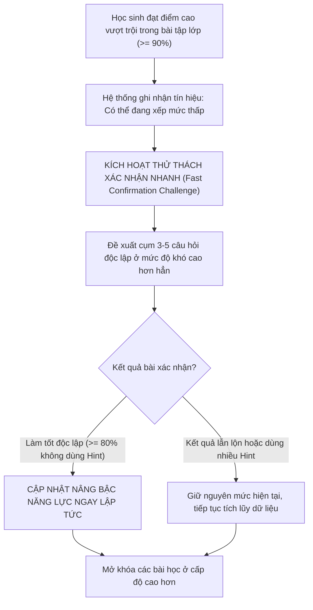
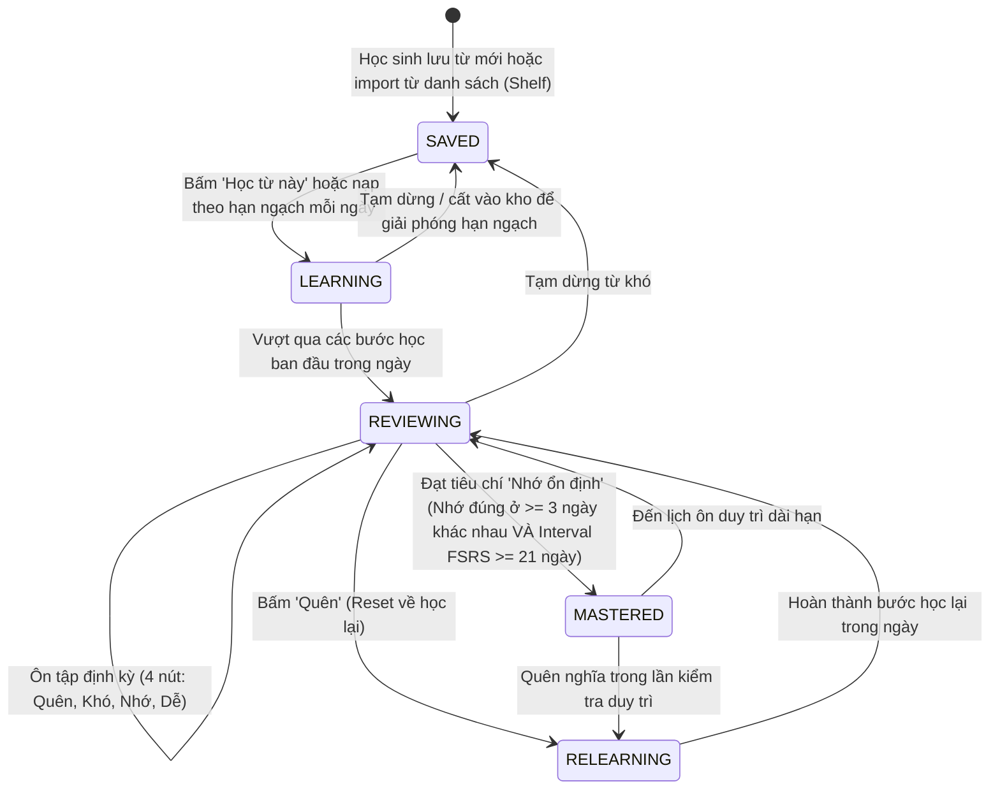

# 23 - Adaptive Engine, Content Ingestion & System Guardrails Specification

## Goal
Quy định chi tiết 5 cơ chế kỹ thuật và sư phạm cốt lõi phục vụ phiên bản sản phẩm hoàn chỉnh:
1. Mô hình học thích ứng lai 3 cơ chế (Hybrid Adaptive Model: Elo/IRT + Skill Mastery + FSRS).
2. Cơ chế xác nhận nâng bậc "Anti-Smurf" từ kết quả bài tập lớp.
3. Quy chuẩn nhập liệu giáo án DOCX với hai luồng phân tách độc lập.
4. Quản lý tủ từ vựng 3 tầng (Saved vs. Learning vs. Mastered) kiểm soát nợ ôn tập.
5. Ràng buộc hành vi của AI Tutor theo máy trạng thái thực của bài tập.
6. Nguyên tắc bản quyền học liệu và truy xuất nguồn gốc nội dung (Provenance).

---

## 1. MÔ HÌNH HỌC THÍCH ỨNG LAI 3 CƠ CHẾ (THE HYBRID ADAPTIVE ENGINE)

Hệ thống không sử dụng một thuật toán đơn lẻ mà kết hợp 3 cơ chế chuyên biệt giải quyết 3 bài toán sư phạm khác nhau:

```
┌────────────────────────────────────────────────────────────────────────┐
│                   HYBRID ADAPTIVE ENGINE ARCHITECTURE                  │
├────────────────────────┬─────────────────────────┬─────────────────────┤
│ Cơ Chế                 │ Mô Hình Tham Chiếu      │ Vai Trò Nghiệp Vụ   │
├────────────────────────┼─────────────────────────┼─────────────────────┤
│ 1. Năng lực & Độ khó   │ Elo / IRT (Birdbrain)   │ Chọn bài vừa sức    │
│ 2. Mục tiêu vi mô      │ Bayesian Knowledge / BKT│ Đồ thị Skill Mastery│
│ 3. Trí nhớ dài hạn     │ FSRS / Spaced Repetition│ Lên lịch thẻ từ vựng│
└────────────────────────┴─────────────────────────┴─────────────────────┘
```

### 1.1. Cơ Chế 1: Ước Lượng Năng Lực & Độ Khó (Elo / IRT-inspired)
* **Mục tiêu**: Đảm bảo bài học luôn nằm trong "Vùng phát triển gần nhất" (Zone of Proximal Development - ZPD) của người học.
* **Nguyên lý**: 
  * Cả người học ($R_{learner}$) và bài học ($D_{item}$) đều có điểm số năng lực/độ khó nội bộ.
  * Tỷ lệ trả lời đúng kỳ vọng được tính theo hàm xác suất Logistic.
  * Nếu người học làm bài có độ khó tương đương với tỷ lệ đúng 70–80%, hệ thống ghi nhận trạng thái học tập lý tưởng (Flow State).
* **Độ co giãn tham số (K-factor Elasticity)**:
  * Khi hồ sơ mới tạo (ít dữ liệu): Hệ số điều chỉnh lớn ($K_{high}$) để nhanh chóng tìm thấy khoảng trình độ thực tế.
  * Khi hồ sơ đã tích lũy ổn định ($> 50$ bài): Hệ số điều chỉnh nhỏ ($K_{low}$) để tránh biến động điểm bốc đồng do 1 bài làm sai sót ngẫu nhiên.

### 1.2. Cơ Chế 2: Đồ Thị Năng Lực Vi Mô (Skill-Graph Mastery)
* Elo chỉ cho biết độ khó tổng thể, không chỉ ra được người học đang hổng kiến thức gì.
* Hệ sinh thái phân rã kỹ năng thành các Node mục tiêu nhỏ (ví dụ: `Reading -> Matching Headings`, `Grammar -> Past Simple vs Past Continuous`).
* Mỗi Node theo dõi tỷ lệ làm chủ độc lập (0–100%) dựa trên chuỗi bằng chứng gần nhất.

### 1.3. Cơ Chế 3: Bộ Lên Lịch Trí Nhớ FSRS (Free Spaced Repetition Scheduler)
* Áp dụng riêng cho **Bộ Từ Vựng Cá Nhân (Vocabulary Bank)**.
* Mô hình hóa trí nhớ theo 3 tham số: Độ ổn định ($S$ - Stability), Độ khó ($D$ - Difficulty), và Khả năng nhớ lại ($R$ - Retrievability).
* Tự động tính toán khoảng cách ngày ôn tập tối ưu để đạt mục tiêu ghi nhớ 90% (Target Retention).

---

## 2. CƠ CHẾ XÁC NHẬN NHANH "ANTI-SMURF" TỪ ĐIỂM LỚP HỌC

### Vấn Đề
Người học có năng lực cao khi mới tham gia hệ thống hoặc học sinh tiến bộ vượt bậc trên lớp không được phép bị giữ lại ở các bài tự học quá dễ (Smurfing/Boredom Trap). Tuy nhiên, đề kiểm tra của giáo viên trên lớp có độ khó không đồng nhất, không thể cộng thẳng điểm lớp vào thang đo năng lực tự học.

### Giải Pháp: Quy Trình Kích Hoạt Xác Nhận Nhanh (Fast Confirmation Flow)



---

## 3. IMPORT GIÁO ÁN DOCX: HAI LUỒNG XỬ LÝ PHÂN TÁCH ĐỘC LẬP

Hệ thống cung cấp công cụ nhập liệu tài liệu DOCX cho giáo viên với hai kịch bản hoàn toàn khác nhau:

```
                            [UPLOAD FILE .DOCX]
                                     │
         ┌───────────────────────────┴───────────────────────────┐
         ▼                                                       ▼
[LUỒNG A: DOCX CÓ ĐỀ SẴN]                              [LUỒNG B: DOCX CHỈ CÓ NỘI DUNG]
• Mục tiêu: Số hóa đề thi có sẵn                       • Mục tiêu: Sinh đề mới từ tài liệu thô
• Giữ nguyên 100% nội dung gốc                          • AI tự sinh câu hỏi & đáp án
• AI chỉ làm nhiệm vụ Parse cấu trúc                   • AI làm nhiệm vụ Sáng tạo & Biên soạn
```

### 3.1. Chi Tiết So Sánh Hai Luồng Nhập Liệu

| Tiêu Chí | Luồng A: DOCX Có Đề Sẵn (Exam Parser) | Luồng B: DOCX Chỉ Có Nội Dung (Raw Material Generator) |
| :--- | :--- | :--- |
| **Đầu vào** | Tệp Word đã có câu hỏi, các lựa chọn A/B/C/D, gạch chân hoặc bảng đáp án. | Bài báo, bài đọc, tài liệu khoa học, ghi chú bài giảng chưa có câu hỏi. |
| **Nhiệm vụ của AI** | Trích xuất câu hỏi, đoạn văn, phân loại dạng bài, bóc tách đáp án chính xác. | Đọc hiểu văn bản, xác định ý chính, sinh câu hỏi trắc nghiệm/điền từ/tự luận, tạo đáp án và lời giải thích. |
| **Trách nhiệm của Teacher** | Kiểm tra xem hệ thống có cắt đúng câu chữ, đúng đáp án gốc của đề không. | Thẩm định tính chính xác của câu hỏi, kiểm tra xem câu hỏi có căn cứ trong bài đọc không, có bị ảo giác (hallucination) không. |
| **Cảnh báo bắt buộc** | **Báo động đỏ nếu đề thiếu đáp án**; gắn nhãn các đáp án do AI suy đoán; thông báo rõ các dạng câu hỏi chưa hỗ trợ. | Gắn nhãn các nhận định suy luận; cảnh báo câu hỏi có thể gây tranh cãi. |

### 3.2. Ba Nguyên Tắc Bất Biến Khi Xử Lý DOCX:
1. **Minh bạch đáp án khuyết**: Đề không có sẵn đáp án thì hệ thống phải đánh dấu rõ `[Thiếu đáp án gốc - Cần giáo viên xác nhận]`. Tuyệt đối không âm thầm gán đáp án AI rồi coi như đáp án chuẩn.
2. **Không ép kiểu câu hỏi (No Forced Conversion)**: Nếu trong đề có dạng bài nối cột hoặc kéo thả mà hệ thống chưa hỗ trợ tương tác, phải hiển thị cảnh báo `[Dạng bài chưa hỗ trợ số hóa tương tác]`, **tuyệt đối không âm thầm biến thành trắc nghiệm 4 lựa chọn**.
3. **Màn hình Preview của Giáo viên phải giống 100% màn hình của Học sinh (WYSIWYG)**: Giáo viên nhìn thấy chính xác giao diện, cách nhập câu trả lời và cách hệ thống chấm điểm trước khi bấm nút giao bài.

---

## 4. QUẢN LÝ TỦ TỪ VỰNG 5 TRẠNG THÁI (FSRS) & CƠ CHẾ CHỐNG VỠ NỢ ÔN TẬP

Nhằm tránh hiện tượng "vỡ nợ ôn tập" (Review Debt/Overwhelm) khi học sinh lưu quá nhiều từ nhưng không thể ôn hết, tủ từ vựng được quản lý qua 5 trạng thái vòng đời kết hợp thuật toán FSRS (Free Spaced Repetition Scheduler):



### 4.1. 5 Trạng Thái Vòng Đời Của Từ Vựng:
1. **Đã lưu (Saved)**: Từ nằm trong kho cá nhân, chưa kích hoạt tính toán khoảng cách FSRS, không tạo áp lực ôn tập.
2. **Đang học (Learning)**: Từ mới bắt đầu học trong ngày hôm nay, đang chạy các bước củng cố ban đầu.
3. **Đang củng cố (Reviewing)**: Đã qua phiên học đầu tiên, FSRS bắt đầu lên lịch ôn tập ngắt quãng (1, 3, 7, 14 ngày...).
4. **Nhớ ổn định (Mastered / Retained)**: Đạt đủ 2 điều kiện:
   - Nhớ đúng ở **$\ge 3$ ngày khác nhau** trước khi lật thẻ.
   - Thuật toán FSRS tính khoảng cách đến lần ôn tiếp theo **$\ge 21$ ngày** (tương đương thẻ Mature của Anki).
5. **Cần học lại (Relearning / Lapsed)**: Từ từng nhớ nhưng bấm "Quên", cần đưa vào hàng đợi học lại nhanh trước khi trở lại chu kỳ ôn.

### 4.2. Quy Tắc 4 Nút Đánh Giá & Hạn Mức Từ Mới:
* **4 Nút đánh giá**:
  - `Quên (Again)`: Hoàn toàn không nhớ nghĩa trước khi lật mặt sau $\rightarrow$ reset chu kỳ học lại.
  - `Khó (Hard)`: **Vẫn nhớ được** nhưng mất nhiều thời gian suy nghĩ $\rightarrow$ tăng nhẹ khoảng cách (1–2 ngày).
  - `Nhớ (Good)`: Nhớ đúng chuẩn xác $\rightarrow$ tăng khoảng cách theo thuật toán chuẩn.
  - `Dễ (Easy)`: Nhớ ngay lập tức không do dự $\rightarrow$ tăng khoảng cách nhảy vọt.
* **Hạn mức từ mới/ngày (New Card Quota)** do người dùng lựa chọn:
  - *Nhẹ (5 từ/ngày)*: Dễ bắt đầu, duy trì bền vững.
  - *Vừa (10 từ/ngày)*: Mức gợi ý chuẩn ban đầu.
  - *Nhiều (20 từ/ngày)*: Dành cho giai đoạn ôn luyện cường độ cao.
  - *Tùy chỉnh (Custom)*: Người học tự đặt theo mục tiêu.
  - *Không giới hạn (Unlimited)*: Hiển thị cảnh báo rủi ro vỡ nợ ôn tập.
* **Cơ chế ngắt tự động (Overwhelm Protection)**: Khi số thẻ đến hạn ôn tập trong ngày $> 25$ thẻ, hệ thống tự động tạm dừng nạp từ mới từ `Đã lưu` vào `Đang học`, ưu tiên giải quyết dứt điểm thẻ đến hạn.

---

## 5. RÀNG BUỘC HÀNH VI AI TUTOR THEO TRẠNG THÁI BÀI TẬP THỰC TẾ

Quy chế "Chống làm hộ bài" phải được **thực thi ở tầng logic hệ thống (State Machine Enforcement)**, không phó mặc cho câu lệnh prompt của AI:

| Trạng Thái Câu Hỏi / Bài Tập | Quyền Hỗ Trợ Của AI Tutor | Hành Vi Cụ Thể Được Phép |
| :--- | :--- | :--- |
| **1. Chưa trả lời (Unanswered)** | Chỉ gợi mở phương pháp (Scaffolding Only) | Giải thích nghĩa từ vựng, nhắc lại quy tắc ngữ pháp, đưa câu ví dụ tương tự. **Khóa hoàn toàn chức năng xuất ra đáp án hoặc loại trừ phương án sai**. |
| **2. Đã trả lời trong bài Tự học (Answered Self-Study)** | Giải thích toàn diện (Formative Feedback) | Phân tích tại sao đáp án của học sinh sai, chỉ ra bẫy tư duy, cung cấp lời giải thích chi tiết và câu hỏi tương tự để sửa lỗi. |
| **3. Đã nộp bài lớp, chờ giáo viên trả (Submitted Homework)** | Giới hạn theo quy chế lớp học (Strict Lockdown) | Không tiết lộ đáp án chính xác hoặc bài giải chi tiết cho đến khi giáo viên chính thức công bố kết quả cho cả lớp. |
| **4. Đã được giáo viên trả bài (Returned with Feedback)** | Cố vấn củng cố kiến thức (Remediation Coach) | Giải thích nhận xét của giáo viên, hướng dẫn sửa bài luận và kích hoạt các bài tập vi mô để khắc phục điểm yếu. |

* **Quy tắc phân định trạng thái**: `"Đã nộp một đáp án"` **KHÔNG ĐỒNG NGHĨA VỚI** `"Được phép xem đáp án"`. Nếu bài tập lớp cho phép làm lại nhiều lần (Retries allowed), học sinh nộp lần 1 sai chỉ nhận được gợi ý điều chỉnh, không được mở toàn bộ đáp án.

---

## 6. NGUYÊN TẮC BẢN QUYỀN VÀ TRUY XUẤT NGUỒN GỐC HỌC LIỆU (CONTENT PROVENANCE)

1. **Tuân thủ bản quyền nội dung (Copyright Compliance)**:
   * Mục đích giáo dục hoặc phi lợi nhuận **không đồng nghĩa với quyền tự do cào dữ liệu (scraping) và xuất bản lại nguyên văn bài đọc/audio có bản quyền**.
   * Hệ thống chỉ sử dụng các nguồn tài liệu thuộc phạm vi công cộng (Public Domain), giấy phép Creative Commons (CC-BY, CC-BY-SA), hoặc văn bản do hệ sinh thái tự biên soạn / hợp tác cấp phép.
2. **Metadata Truy xuất Nguồn gốc (Provenance Tracking)**:
   * Mọi bài đọc, bài nghe và câu hỏi trong hệ thống đều phải lưu trường thông tin nguồn:
     `source_license: "CC-BY-4.0" | "Original" | "PublicDomain"`, `attribution_text: "Adapted from OpenStax / Voice of America"`, `license_terms_url: "..."`.
   * Minh bạch nguồn gốc giúp giải trình chất lượng học thuật và bảo đảm tính chuyên nghiệp khi trình diễn giải pháp trước hội đồng giáo dục và nhà đầu tư.
