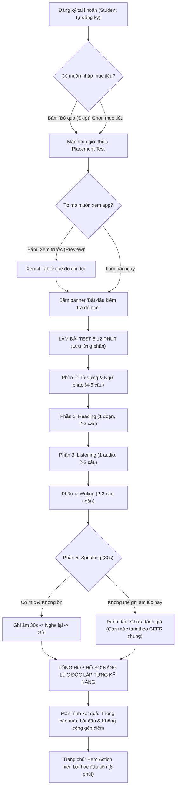
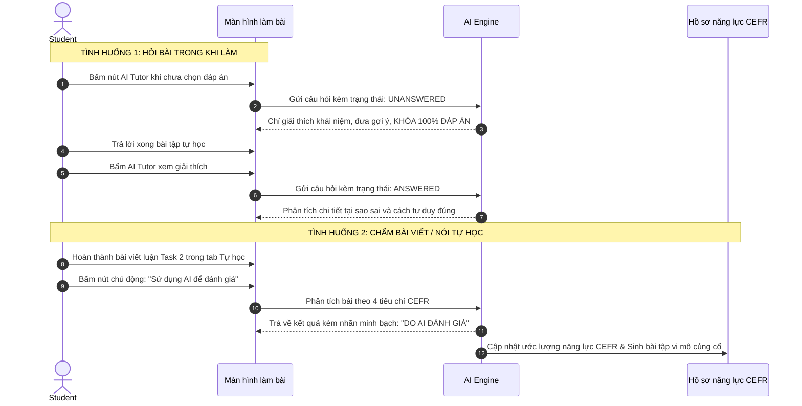
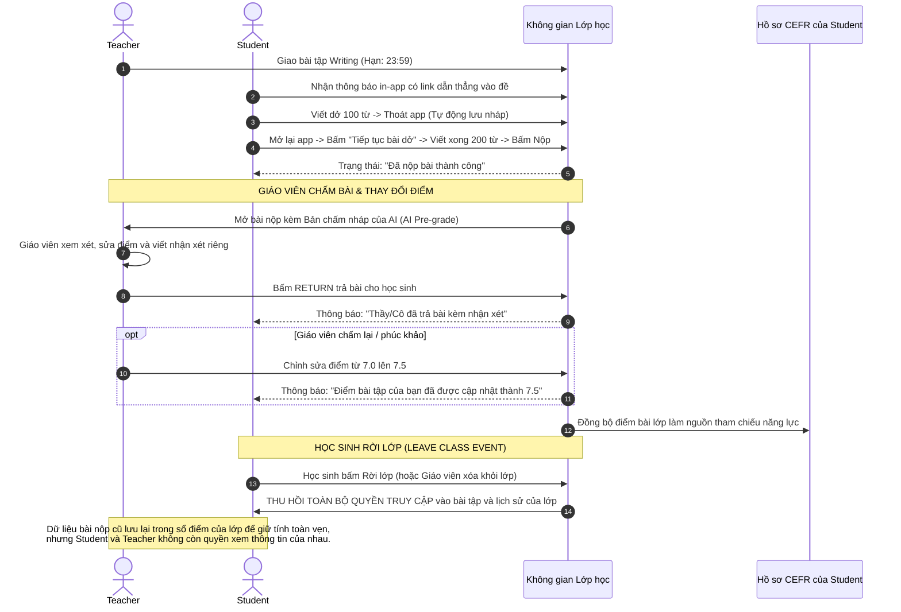

# 26 - End-to-End Role Journeys Specification

## Goal
Tài liệu này đặc tả chi tiết 6 hành trình người dùng toàn diện (End-to-End Journeys) bao quát toàn bộ các vai trò và tính năng chính, làm rõ các điểm giao nhau (Intersection Points) giữa Lớp học và Tự học, cơ chế xử lý ngoại lệ và các bước chuyển trạng thái thực tế.

---

## JOURNEY 1: HÀNH TRÌNH ONBOARDING & THIẾT LẬP HỒ SƠ ĐẦU TIÊN (STUDENT)

* **Quy tắc vàng của Test đầu vào**:
  1. Chỉ thực hiện **MỘT LẦN DUY NHẤT** trong vòng đời tài khoản. (Khác với bài kiểm tra Nhảy trình sau này).
  2. Bị gián đoạn mạng hoặc hết pin: Quay lại làm tiếp đúng phần dở, không phải làm lại từ đầu.
  3. Mức của Speaking khi chưa ghi âm chỉ là mức ước lượng tạm thời; bài luyện nói đầu tiên sẽ là nơi chính thức ghi nhận bằng chứng.

---

## JOURNEY 2: HÀNH TRÌNH TỰ HỌC KỸ NĂNG & GHI NHẬN HỖ TRỢ (SKILL LEARNING & SCAFFOLDING)

1. **Lựa chọn bài học**:
   * Người học vào tab `HỌC`, chọn kỹ năng `[Reading]` $\rightarrow$ Hệ thống đề xuất bài đọc phù hợp mức CEFR hiện tại (B1).
2. **Trải nghiệm bài tập & Phản hồi 4 bước**:
   * *Câu 1*: Người học tự trả lời độc lập và đúng $\rightarrow$ Hệ thống ghi nhận nhãn `scaffold: INDEPENDENT` (Tính trọn vẹn điểm tăng năng lực).
   * *Câu 2 (Câu khó)*: Người học trả lời sai lần 1 $\rightarrow$ Giao diện rung nhẹ, **không hiện đáp án đúng ngay**. Nút `[Xem Gợi Ý (Hint)]` sáng lên.
   * Người học bấm xem gợi ý và trả lời đúng lần 2 $\rightarrow$ Hệ thống ghi nhận nhãn `scaffold: HINT_ASSISTED` (Tính là một lần ôn củng cố, không vội tăng độ khó bài sau).
   * *Câu 3 (Nhập đáp án - Lỗi chính tả / Typo)*:
     * Người học gõ *"accomodation"* (thiếu chữ 'm').
     * Hệ thống nhận diện lỗi chính tả gần đúng (Typo heuristic): Hiển thị thông báo mềm: *"Bạn viết gần đúng! Hãy chú ý chính tả: accommodation"*. Nếu bài học không nhằm mục đích kiểm tra spelling chuyên biệt, câu này được chấp nhận nhưng có cảnh báo nhắc nhở.
3. **Củng cố cuối bài (Remedial Clone)**:
   * Cuối phiên học, hệ thống tự động sinh 1 câu hỏi tương tự câu 2 để người học kiểm tra lại xem mình đã tự làm chủ kiến thức chưa.

---

## JOURNEY 3: HÀNH TRÌNH ÔN TỪ ANKI & QUẢN LÝ TỦ TỪ 3 TẦNG (VOCABULARY QUEUE)

1. **Khởi động phiên ôn từ**:
   * Tại tab `ÔN TỪ`, Hero Card báo: *“Ôn 14 từ đến hạn hôm nay”*.
   * Trong tủ cá nhân có 120 từ: 60 từ ở nhóm `Đã lưu (Saved)`, 40 từ ở nhóm `Đang học (Learning)`, và 20 từ ở nhóm `Đã nhớ ổn định (Mastered)`.
2. **Thực hiện lật thẻ Active Recall**:
   * Mặt trước thẻ hiện từ vựng và câu khuyết. Người học **bắt buộc tự nhớ nghĩa trong đầu trước khi chạm để lật thẻ**.
   * Chạm lật thẻ: Mặt sau hiện nghĩa tiếng Việt và câu hoàn chỉnh.
   * Người học đánh giá trung thực: Bấm `[LẠI]` (thẻ lặp lại sau 3 thẻ nữa), `[KHÓ]`, `[TỐT]`, hoặc `[DỄ]`.
3. **Kiểm soát nợ ôn tập (Backlog Control)**:
   * Nếu người học bận rộn và thẻ tồn đọng $> 25$ thẻ: Hệ thống tự động kích hoạt chế độ **“Tạm dừng nạp từ mới”**. Người học có thể chọn **Phiên ôn ngắn (5–10 thẻ)** để giảm áp lực.
   * Khi các từ trong nhóm `Đang học` vượt qua chu kỳ ôn tập $\ge 30$ ngày, chúng tự động chuyển sang nhóm `Đã nhớ ổn định`, giải phóng hạn ngạch để người học nạp thêm từ mới từ nhóm `Đã lưu`.

---

## JOURNEY 4: HÀNH TRÌNH TƯƠNG TÁC AI TUTOR & ĐÁNH GIÁ TỰ LUẬN (AI SUITE)

---

## JOURNEY 5: HÀNH TRÌNH GIÁO VIÊN NHẬP ĐỀ DOCX & GIAO BÀI (TEACHER DOCX INGESTION)

1. **Tải lên tài liệu**:
   * Giáo viên vào `Assignment Creator Studio` $\rightarrow$ Tải lên tệp `Unit3_Test.docx`.
2. **Chọn luồng xử lý**:
   * *Nếu chọn Luồng A (DOCX có đề sẵn)*: Hệ thống parse giữ nguyên 100% câu hỏi và đáp án gốc.
     * Cảnh báo: Câu 7 bị thiếu đáp án $\rightarrow$ Hệ thống đánh dấu cờ đỏ `[AI đã suy luận đáp án C - Cần giáo viên xác nhận]`.
     * Cảnh báo: Câu 12 là dạng nối cột chưa hỗ trợ $\rightarrow$ Hệ thống giữ nguyên dạng văn bản thô để làm thủ công, không ép thành trắc nghiệm.
   * *Nếu chọn Luồng B (DOCX chỉ có nội dung thô)*: AI đọc tài liệu bài giảng và sinh 10 câu hỏi trắc nghiệm mới $\rightarrow$ Hệ thống đánh dấu nhãn `[Nội dung do AI biên soạn]`.
3. **Kiểm tra WYSIWYG & Giao bài**:
   * Giáo viên xem trước màn hình mô phỏng 100% giao diện học sinh.
   * Chỉnh sửa câu chữ, duyệt các đáp án AI suy luận.
   * Cấu hình hạn nộp và bấm `[Xuất bản bài tập]`.

---

## JOURNEY 6: HÀNH TRÌNH LỚP HỌC, CHẤM BÀI & RỜI LỚP (CLASSROOM & REVOCATION)

