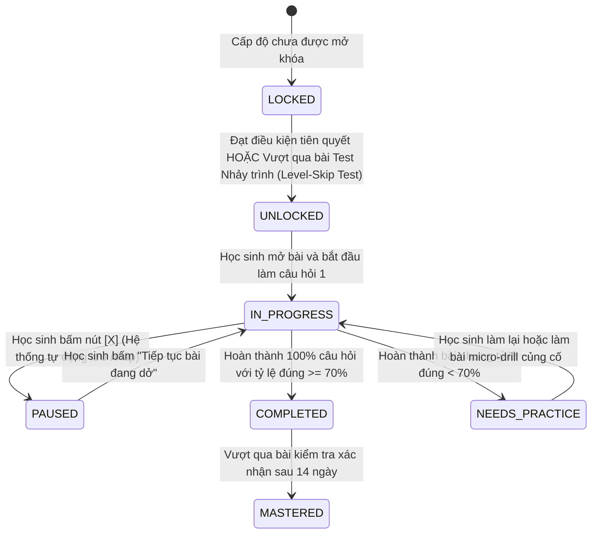
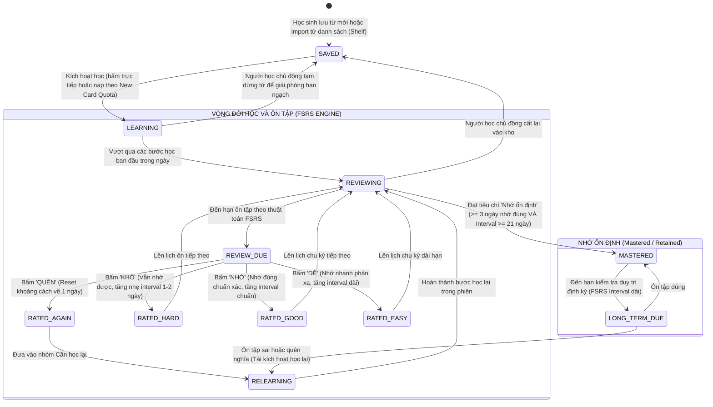
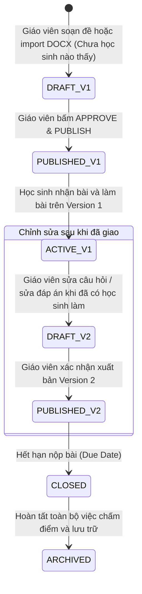
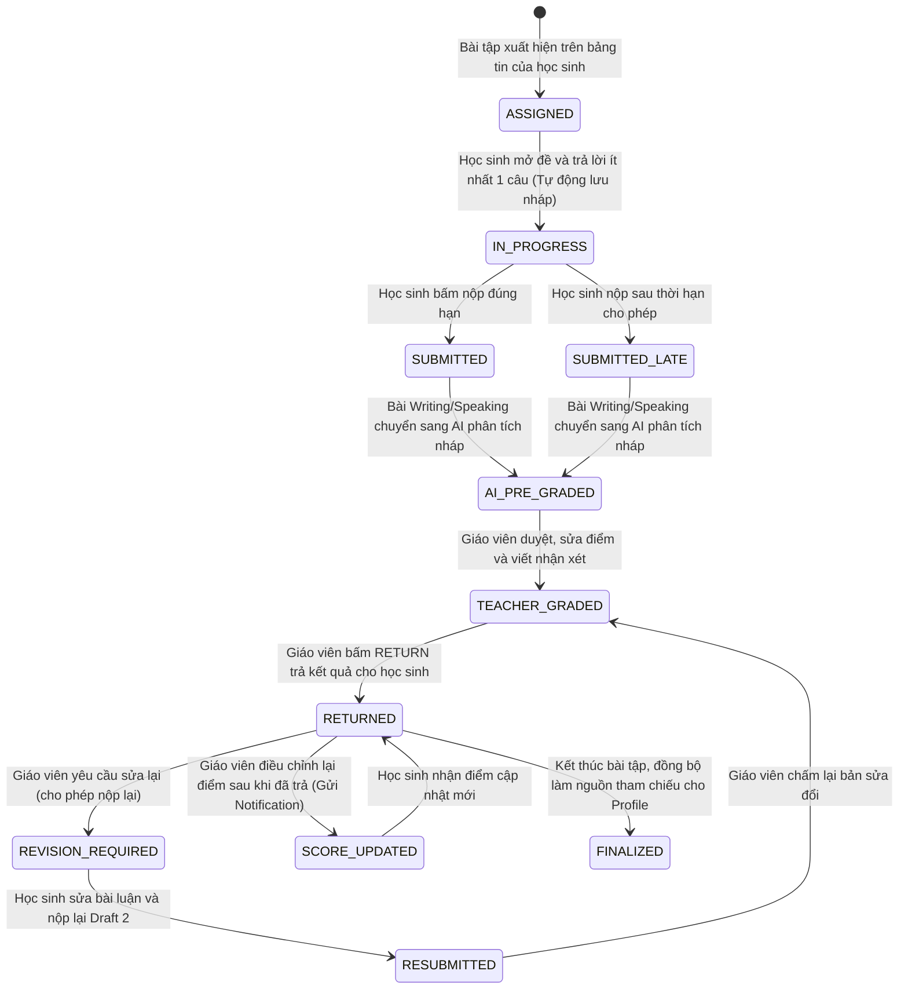
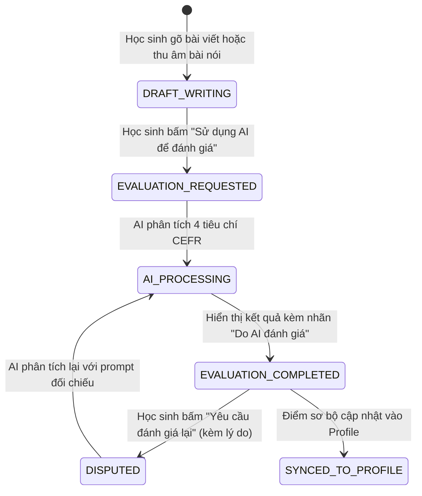

# 27 - Comprehensive State Machines Specification

## Goal
Quy định danh mục các máy trạng thái hữu hạn (Finite State Machines - FSM) chi tiết cho toàn bộ các thực thể cốt lõi trong hệ thống AELP, bao gồm các sự kiện kích hoạt (Events), điều kiện bảo vệ (Guards), hành động chuyển trạng thái (Actions), và cơ chế quản lý phiên bản (Versioning) khi giáo viên sửa đề.

---

## 1. LESSON / ACTIVITY STATE MACHINE (TIẾN ĐỘ BÀI HỌC)

* **Phân biệt rạch ròi**: `"Hoàn thành bài (Completed)"` chỉ ghi nhận người học đã đi qua toàn bộ nội dung của bài; `"Làm chủ (Mastered)"` đòi hỏi sự thuần thục ổn định qua thời gian.

---

## 2. VOCABULARY MEMORY STATE MACHINE (TỦ TỪ 5 TRẠNG THÁI & THUẬT TOÁN FSRS)

* **Tiêu chuẩn "Nhớ ổn định" (Mastered)**: Nhãn sản phẩm dựa trên bằng chứng ghi nhớ thực nghiệm:
  1. Người học đã vượt qua giai đoạn củng cố ban đầu.
  2. Trả lời đúng ở **$\ge 3$ ngày khác nhau** trước khi lật mặt sau xem đáp án.
  3. Thuật toán FSRS lên lịch khoảng cách ôn tiếp theo **$\ge 21$ ngày** (tương đương chuẩn thẻ Mature của Anki).

---

## 3. ASSIGNMENT LIFECYCLE & VERSIONING STATE MACHINE (BÀI TẬP & PHIÊN BẢN)

Khi giáo viên chỉnh sửa bài tập sau khi đã giao, hệ thống **bảo toàn lịch sử phiên bản (`version_id`)** để bài làm của học sinh không bị xung đột:

* **Quy tắc phiên bản đề (Assignment Versioning Rule)**:
  * Nếu học sinh đã nộp bài ở `Version 1`: Bài nộp gắn chặt với đề `Version 1`. Điểm số được chấm theo đáp án của Version 1.
  * Nếu học sinh đang làm dở ở `Version 1` khi giáo viên công bố `Version 2`: Hệ thống hiển thị thông báo: *"Giáo viên vừa cập nhật đề bài (V2). Bạn có muốn chuyển sang bản cập nhật không?"*. Nếu đồng ý, các câu hỏi không thay đổi được giữ nguyên câu trả lời.
  * Học sinh bắt đầu làm sau thời điểm xuất bản V2 sẽ tự động nhận đề `Version 2`.

---

## 4. SUBMISSION & GRADING STATE MACHINE (BÀI NỘP & CHẤM ĐIỂM)

---

## 5. QAC & AI EVALUATION STATE MACHINE (TỰ HỌC WRITING / SPEAKING)

Đối với bài tự học khi không có giáo viên chấm:

