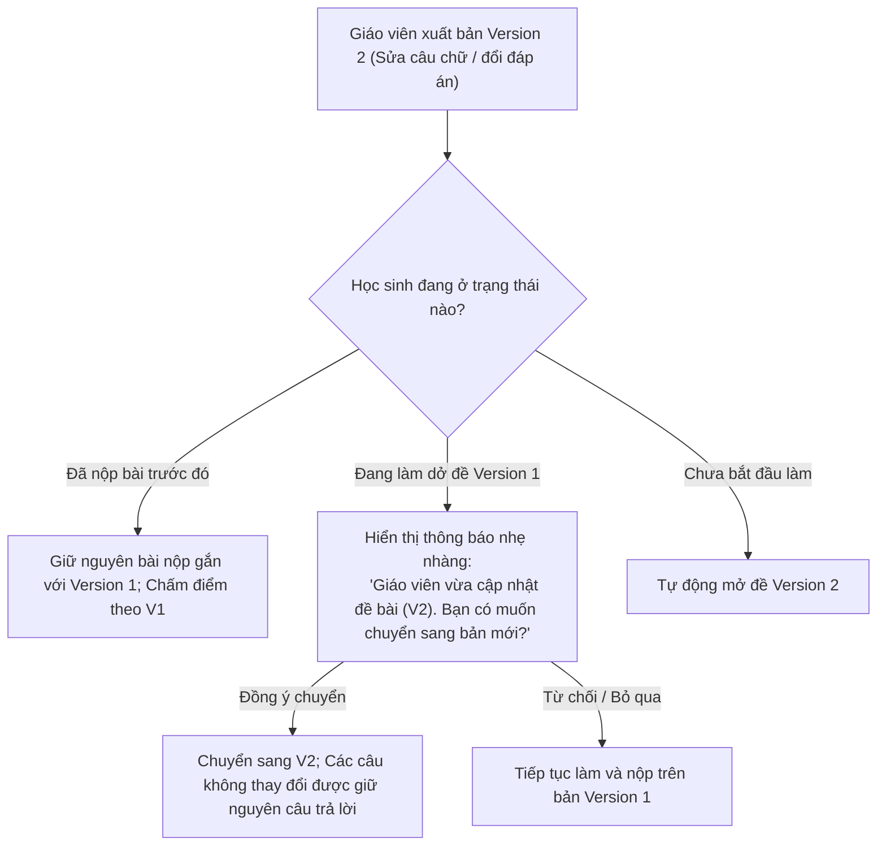
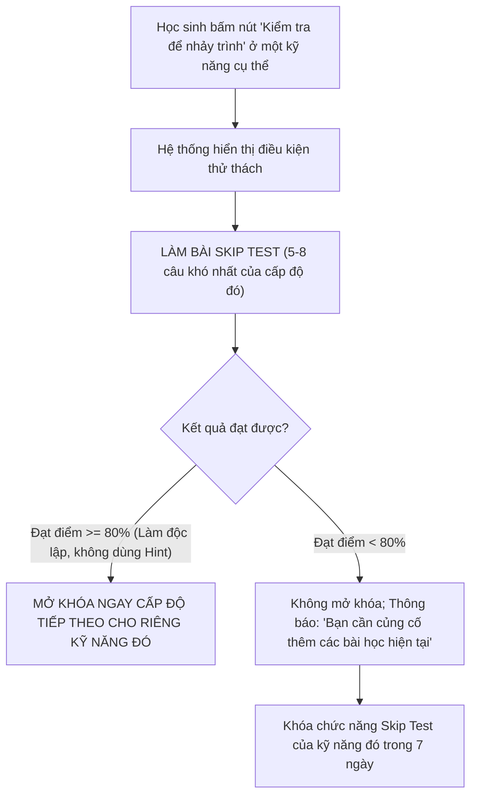

# 28 - Exception Handling & Recovery Flows Specification

## Goal
Tài liệu này chuẩn hóa toàn bộ các kịch bản ngoại lệ (Edge Cases / Exceptions), cơ chế tự phục hồi dữ liệu (Self-Recovery), và quy tắc kiểm soát rủi ro mạng/thiết bị nhằm bảo vệ tiến trình học tập của người dùng và tính toàn vẹn học thuật của hệ thống.

---

## 1. MẤT MẠNG, TẢI LẠI TRANG & ĐỔI THIẾT BỊ (NETWORK & DEVICE DISRUPTIONS)

### 1.1. Mất Mạng Trong Khi Đang Làm Bài (Network Drop-off)
* **Cơ chế lưu trữ ngoại tuyến (Client-side Local Cache)**:
  * Mỗi câu trả lời của học sinh, mỗi câu gõ trong bài viết Writing được lưu ngay lập tức vào bộ nhớ cục bộ (LocalStorage / IndexedDB).
  * Góc trên màn hình chuyển sang trạng thái: `Offline - Đang lưu cục bộ`.
* **Cơ chế khôi phục (Auto-reconnect & Sync)**:
  * Khi có mạng trở lại, hệ thống tự động đẩy dữ liệu từ bộ đệm lên máy chủ ở chế độ chạy ngầm (Background Sync).
  * Hiển thị Toast thông báo: *“Đã kết nối lại và đồng bộ tiến trình của bạn lên hệ thống”*.

### 1.2. Tải Lại Trang Đột Ngột Hoặc Đóng Trình Duyệt (Page Refresh / App Kill)
* Người dùng không bao giờ bị mất bài. Khi mở lại app/web:
  * Nút Hero Action tại Trang chủ hiển thị ngay: **“Tiếp tục bài đang dở: [Tên bài học] (Câu 4/10)”**.
  * Chạm 1 lần đưa người học vào **chính xác câu hỏi và nội dung đang gõ dở**.

### 1.3. Đổi Thiết Bị (Device Switch)
* Người học làm 5 câu trên điện thoại, sau đó mở máy tính bàn đăng nhập cùng tài khoản:
  * Hệ thống khôi phục trạng thái từ bản đồng bộ máy chủ gần nhất.
  * Nếu thiết bị điện thoại cũ chưa kịp đồng bộ (do mất mạng): Màn hình trên máy tính hiển thị cảnh báo: *"Có thay đổi chưa được đồng bộ từ thiết bị điện thoại. Bạn có muốn sử dụng bản lưu gần nhất trên đám mây không?"*.

---

## 2. RỦI RO GHI ÂM SPEAKING & QUYỀN MICROPHONE

### 2.1. Đệm Âm Thanh Cục Bộ (Local Audio Buffering)
* Tệp ghi âm Speaking được ghi và xử lý cục bộ trước khi upload.
* Sau khi thu âm 30 giây, màn hình cung cấp nút `[Nghe lại]` và thanh sóng âm (Waveform).
* Nếu phát hiện âm lượng quá nhỏ ($< 10\text{dB}$) hoặc tạp âm quá lớn, hệ thống cảnh báo: *"Không nghe rõ tiếng nói. Hãy thử lại ở nơi yên tĩnh hơn"*.

### 2.2. Xử Lý Khi Không Có Mic Trong Test Đầu Vào
* Người học bấm nút: `[Không thể ghi âm lúc này]`.
* **Quy tắc hệ thống**:
  1. Cho phép hoàn thành 4 phần còn lại bình thường.
  2. Speaking được gán mức **Khởi đầu Tạm thời (Temporary Baseline)** tương đương với mức ước lượng trung bình của các phần kia để người học vẫn có bài luyện nói phù hợp.
  3. Màn hình thông báo rõ: *“Năng lực Nói chưa được xác nhận chính thức. Bài luyện nói đầu tiên của bạn sẽ là nơi thu thập bằng chứng thực tế”*.
  4. **Tuyệt đối không dùng điểm Writing để tính toán điểm Speaking**.

---

## 3. NGOẠI LỆ NỘP BÀI THẤT BẠI (SUBMISSION FAILURE GUARD)

* **Nguyên tắc "Biên nhận máy chủ" (Server Confirmation Receipt)**:
  * Khi người học bấm `[Nộp bài]`, giao diện chuyển sang trạng thái `Đang nộp...` (Loading).
  * **TUYỆT ĐỐI KHÔNG HIỂN THỊ "ĐÃ NỘP THÀNH CÔNG"** nếu máy chủ chưa gửi về mã biên nhận thành công (`receipt_id`).
  * Nếu mạng bị ngắt giữa lúc gửi: Hiển thị hộp thoại lỗi thân thiện:  
    *“Không thể gửi bài nộp do mạng gián đoạn. Bài làm của bạn đã được lưu an toàn. Bấm [Thử nộp lại] khi có mạng”*.
  * Nút `[Thử nộp lại]` thử gửi lại gói tin từ bộ đệm cục bộ mà không bắt học sinh làm lại.

---

## 4. GIÁO VIÊN SỬA ĐỀ KHI HỌC SINH ĐANG LÀM (IN-PROGRESS ASSIGNMENT MUTATION)

---

## 5. HỌC SINH RỜI LỚP HOẶC BỊ XÓA KHỎI LỚP (LEAVE / REMOVAL REVOCATION)

* **Quy tắc thu hồi quyền truy cập tức thì (Immediate Access Revocation)**:
  * Khi học sinh bấm `[Rời lớp]` hoặc giáo viên bấm `[Xóa học sinh khỏi lớp]`:
  * **Học sinh MẤT TOÀN BỘ QUYỀN TRUY CẬP** vào danh sách bài tập, tài liệu nội bộ, và lịch sử bài nộp của lớp học đó. Tab `Lớp học` không còn hiển thị lớp này.
  * **Bảo toàn dữ liệu lịch sử lớp**: Bài nộp cũ của học sinh vẫn được lưu giữ trong Sổ điểm (Gradebook) của lớp dưới dạng tài khoản lưu trữ (Archived Student) để giáo viên bảo toàn điểm số tổng kết của lớp.
  * **Cắt đứt liên lạc dữ liệu**: Giáo viên không còn quyền xem hồ sơ năng lực tự học của học sinh đó kể từ thời điểm rời lớp.

---

## 6. XỬ LÝ LỖI CHÍNH TẢ & ĐÁP ÁN GẦN ĐÚNG (SPELLCHECK & TYPO HEURISTICS)

Để tránh trải nghiệm ức chế khi người học hiểu bài nhưng gõ nhầm bàn phím (Typo):
* **Thuật toán so khớp khoảng cách Levenshtein (Distance $\le 1$)**:
  * Nếu từ gõ sai chỉ lệch 1 ký tự (ví dụ: *"enviroment"* thay vì *"environment"*):
    * *Trường hợp A (Bài tập không chuyên về chính tả)*: Chấp nhận đáp án là **Đúng**, nhưng hiển thị viền vàng và thông báo nhắc nhở nhẹ nhàng: *"Chính xác! Lưu ý chính tả chuẩn là: environment"*.
    * *Trường hợp B (Bài tập kiểm tra chính tả hoặc lỗi làm biến đổi thành từ khác có nghĩa)* (ví dụ: *"weather"* thành *"whether"*): **Chấm Sai** và giải thích rõ sự nhầm lẫn ngữ nghĩa.

---

## 7. BÀI KIỂM TRA NHẢY TRÌNH KỸ NĂNG (SKILL-BASED LEVEL-SKIP TEST)

Học sinh không bị ép buộc phải học tuần tự nếu cảm thấy trình độ hiện tại quá dễ:

* **Quy tắc Skip Test**:
  1. **Nhảy theo từng kỹ năng độc lập**: Nhảy trình Reading không tự động nhảy trình Speaking.
  2. **Giới hạn thử lại**: Tối đa 1 lần thử cho mỗi kỹ năng trong vòng 7 ngày để chống đoán mò.
