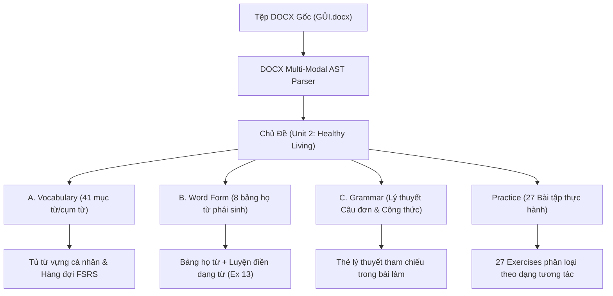

# Đặc Tả Kiến Trúc Import DOCX Bộ Học Liệu Theo Chủ Đề (Thematic Study Pack)

> **Tài liệu tham chiếu chuẩn hóa dựa trên bộ kiểm thử thực tế:** `GỦI.docx` (Unit 2: HEALTHY LIVING)  
> **Phiên bản:** 2.0 — Thematic & Multi-Exercise Pipeline  

---

## 1. Bản Chất Học Liệu: Bộ Bài Theo Chủ Đề (Thematic Study Pack)

Khác với quy trình số hóa trắc nghiệm phẳng, học liệu thực tế trong giảng dạy tiếng Anh thường được tổ chức dưới dạng một **Thematic Study Pack** hoàn chỉnh bao gồm 4 khối thành phần hữu cơ:

---

## 2. Các Dạng Component Tương Tác Cốt Lõi

Để đáp ứng trọn vẹn 27 bài tập trong tệp kiểm thử `GỦI.docx`, hệ thống triển khai 3 component chuyên dụng mới:

### 2.1. `InlineWordSelector` (Chọn từ/cụm từ trực tiếp trong câu)
* **Mục đích**: Phục vụ các bài tập phân tích cú pháp câu như:
  * **Exercise 9**: Gạch chân Chủ ngữ (Subject) và Khoanh tròn Động từ (Verb).
  * **Exercise 10**: Nhận diện thành phần gạch chân là Tân ngữ (Object) hay Trạng từ (Adverb).
* **Cơ chế tương tác**:
  * Tách chuỗi câu thành các tokens.
  * Nhấp chuột lần 1: Gạch chân Subject (`border-b-4 border-primary`).
  * Nhấp chuột lần 2: Khoanh tròn Verb (`border-2 border-emerald-500 rounded-full`).
  * Nhấp chuột lần 3: Hoàn tác trạng thái.

### 2.2. `WordBankFill` (Điền từ từ ngân hàng từ cho sẵn)
* **Mục đích**: Phục vụ **Exercise 8** (`soybeans`, `suncream`, `affects`, `early`, `for`, `tired`).
* **Cơ chế tương tác**:
  * Hiển thị hộp từ (Word Bank) phía trên.
  * Học sinh chọn ô trống muốn điền $\rightarrow$ Bấm vào từ trong bank $\rightarrow$ Từ nhảy vào ô trống và gạch ngang trong bank.
  * Bấm nút "×" trên ô trống để thu hồi từ về lại bank.

### 2.3. `TrueFalseTable` (Bảng True / False giữ nguyên định dạng)
* **Mục đích**: Phục vụ **Exercise 31** và các bài đọc/nghe kiểm tra True/False.
* **Cơ chế tương tác**:
  * Giữ nguyên cấu trúc bảng 4 cột: `No.`, `Statements`, `T`, `F`.
  * Học sinh nhấp vào cột T hoặc F để hiển thị dấu **X** đậm nét, trực quan như trên giấy thi.

---

## 3. Các Nguyên Tắc Xử Lý Dữ Liệu Khi Import DOCX

| Yêu cầu kỹ thuật | Cách xử lý trong Pipeline | Ví dụ kiểm chứng |
|---|---|---|
| **Bảo toàn định dạng bài sắp xếp** | Giữ nguyên dạng trắc nghiệm A/B/C/D gốc; **tuyệt đối không tự ý chuyển thành kéo thả**. | Exercise 15, 27, 28 (chọn thứ tự A. a-b-c, B. c-a-b...) |
| **Giữ formatting (In đậm / Gạch chân)** | Giữ thẻ formatting `bold` và `underline` trong AST để xác định phần tử cần phân loại cú pháp. | Exercise 9, 10 |
| **Giữ bảng và cấu trúc ô** | Parser đọc thẻ `w:tbl`, `w:tr`, `w:tc` để bảo toàn bảng 2 chiều và dấu X trong cột. | Exercise 31 |
| **Trích xuất & Ánh xạ 15 ảnh nhúng** | Trích xuất ảnh nhị phân từ thư mục `word/media/` và ánh xạ khóa ngoại tới đúng câu hỏi tương ứng. | Exercise 5 (5 ảnh minh họa từ) và Exercise 17 (5 ảnh biển báo) |
| **Kiểm soát thiếu Audio** | Bật cờ cảnh báo đỏ `audioMissing: true`. Yêu cầu Giáo viên tải lên mp3; **không tự suy đoán đáp án chỉ dựa trên text**. | Exercise 29, 30, 31 (Listening) |
| **Phát hiện lỗi nguồn (Source Errors / Typos)** | Giữ nguyên văn bản gốc, hiển thị cảnh báo vàng kèm đề xuất sửa riêng cho Giáo viên review. | Exercise 12 ("Jane feels should...", "Diego is should...") |

---

## 4. Quyền Hạn Của Giáo Viên Khi Nhận Bộ Bài

1. **Lựa chọn phạm vi giao bài**:
   * Giáo viên có thể giao **toàn bộ bộ bài (All-in-One Pack)** hoặc **chọn từng Exercise riêng biệt** (thông qua hệ thống Checkbox).
2. **Quyền gắn vào Khung Chương Trình (Curriculum Mapping)**:
   * Giáo viên tự tay chọn vị trí gắn: **Course $\rightarrow$ Unit $\rightarrow$ Lesson Target**, ngăn chặn việc AI tự coi mỗi file DOCX là một Course riêng lẻ.
