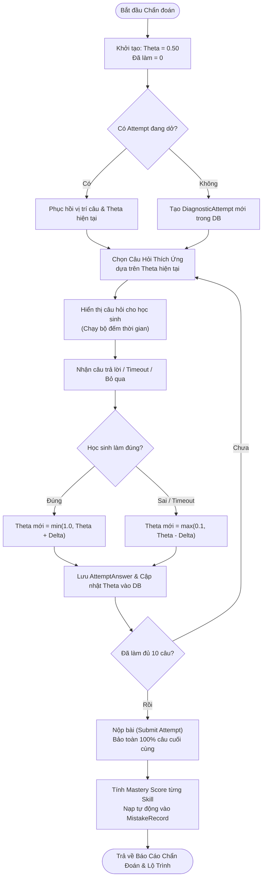

# AdaptiveMath — Đặc Tả Kỹ Thuật Thuật Toán Chẩn Đoán (CAT / IRT)

**Mã tài liệu:** `SPEC-ALGO-01`  
**Phiên bản:** 1.0  
**Tác giả:** AdaptiveMath Engineering & Assessment Team  
**Phạm vi:** Động cơ đánh giá năng lực thích ứng (Computerized Adaptive Testing - CAT) & Quản lý tiến trình học tập cá nhân hóa.

---

## 1. Tổng Quan & Mục Tiêu

Hệ thống chẩn đoán năng lực của **AdaptiveMath** sử dụng mô hình kiểm tra thích ứng máy tính (Computerized Adaptive Testing - CAT) tinh giản dựa trên nền tảng Lý thuyết Ứng đáp Câu hỏi (Item Response Theory - IRT 1PL / Rasch Model) kết hợp thuật toán cập nhật thích ứng theo mức độ nhận thức (Cognitive Level Adaptation).

### Mục tiêu then chốt:
1. **Rút ngắn thời gian làm bài:** Chỉ cần $8 - 10$ câu hỏi là xác định chính xác trình độ học sinh thay vì làm đề thi $40 - 50$ câu truyền thống.
2. **Loại bỏ hiện tượng nản lòng hoặc nhàm chán:** Học sinh yếu không bị dồn dập câu khó; học sinh giỏi không phải làm lặp lại các câu nhận biết cơ bản.
3. **Bảo toàn tính liên tục:** Khả năng Autosave & Resume khi gặp sự cố gián đoạn mạng hoặc đóng trình duyệt.
4. **Đảm bảo tính toàn vẹn:** Khắc phục triệt để lỗi của prototype cũ (rớt câu hỏi cuối cùng của bài thi).
5. **Đồng bộ tự động Sổ tay lỗi sai:** Chuyển các câu làm sai hoặc bị timeout sang `MistakeRecord` để học sinh tự luyện tập lại.

---

## 2. Mô Hình Năng Lực & Phân Loại Câu Hỏi

### 2.1 Thang đo năng lực ($\theta$)
Năng lực của học sinh được biểu diễn bằng tham số $\theta$ (Theta) chuẩn hóa trên khoảng đóng $[0.1, 1.0]$:
- $\theta_0 = 0.50$: Năng lực khởi điểm mặc định (mức trung bình).
- $\theta < 0.40$: Mức cơ bản / cần củng cố kiến thức nền tảng.
- $0.40 \le \theta < 0.70$: Mức thông hiểu / đạt chuẩn kiến thức phổ thông.
- $\theta \ge 0.70$: Mức thành thạo / vận dụng cao, sẵn sàng cho các kỳ thi tuyển sinh.

### 2.2 Ba cấp độ nhận thức & Độ khó tham chiếu ($b$)

Theo chuẩn chương trình GDPT 2018 môn Toán lớp 9:

| Cấp độ nhận thức (`CognitiveLevel`) | Độ khó mục tiêu ($b$) | Biên độ cập nhật ($\Delta \theta$) | Mục đích khảo sát |
|---|:---:|:---:|---|
| **REMEMBERING (Nhận biết)** | $0.20 - 0.40$ | $\pm 0.15$ | Định nghĩa, công thức, nhận dạng ký hiệu toán học. |
| **UNDERSTANDING (Thông hiểu)** | $0.45 - 0.65$ | $\pm 0.20$ | Biến đổi biểu thức, giải phương trình, hệ phương trình cơ bản. |
| **APPLYING (Vận dụng)** | $0.70 - 0.90$ | $\pm 0.25$ | Giải toán bằng cách lập hệ phương trình, bài toán thực tế, hình học tổng hợp. |

---

## 3. Thuật Toán Điều Hướng Thích Ứng (Adaptive Selection Loop)

### 3.1 Quy tắc chọn câu hỏi kế tiếp (`selectNextQuestion`)
1. **Lọc câu hỏi:** Chỉ chọn từ các câu có trạng thái `QuestionStatus.PUBLISHED`.
2. **Chống trùng lặp:** Loại trừ tất cả các `questionId` đã xuất hiện trong danh sách `excludedQuestionIds` của phiên làm bài hiện tại.
3. **Ánh xạ $\theta \to \text{CognitiveLevel}$:**
   - Nếu $\theta < 0.45$: Ưu tiên chọn câu hỏi `REMEMBERING`.
   - Nếu $0.45 \le \theta < 0.70$: Ưu tiên chọn câu hỏi `UNDERSTANDING`.
   - Nếu $\theta \ge 0.70$: Ưu tiên chọn câu hỏi `APPLYING`.
4. **Phân bổ đều kỹ năng:** Ưu tiên chọn các `SkillNode` chưa có câu hỏi nào được trả lời trong attempt hiện tại để đảm bảo độ phủ toàn diện trên 8 kỹ năng trọng tâm của Lớp 9.
5. **Cơ chế Fallback:** Nếu ngân hàng câu hỏi ở cấp độ mục tiêu đã hết, thuật toán tự động mở rộng sang cấp độ lân cận gần nhất.

### 3.2 Công thức cập nhật Theta (`updateTheta`)
Với mỗi câu trả lời:
$$\Delta = \begin{cases} 0.15 & \text{khi câu hỏi là REMEMBERING} \\ 0.20 & \text{khi câu hỏi là UNDERSTANDING} \\ 0.25 & \text{khi câu hỏi là APPLYING} \end{cases}$$

$$\theta_{k+1} = \begin{cases} \min(1.0, \, \theta_k + \Delta) & \text{nếu trả lời ĐÚNG} \\ \max(0.1, \, \theta_k - \Delta) & \text{nếu trả lời SAI hoặc TIMEOUT hoặc SKIP} \end{cases}$$

---

## 4. Xử Lý Trường Hợp Đặc Biệt & Ngoại Lệ

### 4.1 Timeout và Skip (Bỏ qua)
- **Timeout:** Khi hết thời gian cho phép của một câu hỏi, giao diện gửi cờ `isTimeout = true` và `selectedOptionKey = null`.
- **Skip:** Học sinh chủ động bấm bỏ qua gửi cờ `isSkipped = true`.
- Cả hai trường hợp đều được ghi nhận nguyên vẹn vào bảng `AttemptAnswer` và tính là không đúng ($\theta$ giảm theo công thức).

### 4.2 Bảo toàn câu hỏi cuối cùng (`Final Question Idempotency`)
Trong phiên bản prototype cũ, khi học sinh trả lời câu hỏi cuối cùng (câu số 10) và bấm "Xem kết quả", sự kiện submit xảy ra trước khi câu trả lời số 10 được lưu vào cơ sở dữ liệu, dẫn đến kết quả chỉ hiển thị 9/10 câu.
- **Giải pháp:** API `POST /api/v1/diagnostic/submit/:attemptId` kiểm tra toàn bộ danh sách câu hỏi đã lưu. Nếu câu trả lời cuối cùng chưa được nộp, hệ thống từ chối submit hoặc tự động chốt đáp án trước khi tính toán điểm số tổng kết.

### 4.3 Tính toán Độ Thành Thạo Kỹ Năng (`SkillMastery`)
Sau khi submit bài thi, với mỗi kỹ năng $s$ xuất hiện trong bài thi:
$$\text{MasteryScore}(s) = \frac{\sum \text{CorrectAnswers}_s}{\sum \text{TotalQuestions}_s} \times 100$$

Hệ thống cập nhật vào bảng `SkillMastery` (upsert theo `studentId` và `skillId`), đồng thời phân nhóm:
- $\ge 75\%$: **THÀNH THẠO**
- $50\% - 74\%$: **TRUNG BÌNH**
- $< 50\%$: **CẦN LUYỆN TẬP**

### 4.4 Tự động lưu Sổ tay lỗi sai (`MistakeRecord`)
Mỗi câu hỏi có `isCorrect = false` trong attempt được tự động ghi nhận vào `MistakeRecord`:
- Liên kết trực tiếp với câu hỏi gốc, đề bài, các đáp án và lời giải chi tiết (`explanation`).
- Khởi tạo với cờ `isMastered = false`.
- Cho phép học sinh ghi chú cá nhân (`userNotes`) và đánh dấu đã hiểu sau khi ôn luyện lại.

---

## 5. Kế Hoạch Nâng Cấp Tương Lai (Post-Pilot)

1. **IRT 2PL / 3PL Parameterization:** Bổ sung tham số độ phân biệt ($a$) và xác suất đoán mò ($c$) khi ngân hàng dữ liệu đạt trên 1.000 lượt làm bài thực tế của học sinh.
2. **Sai số chuẩn đo lường (Standard Error of Measurement - SEM):** Thay vì dừng cố định ở câu số 10, bài thi sẽ dừng khi sai số $\text{SEM}(\theta) < 0.25$.
3. **Phát hiện hành vi bất thường (Cheating & Rapid Guessing):** Gắn cờ các câu trả lời dưới 3 giây đối với các câu tính toán phức tạp.
